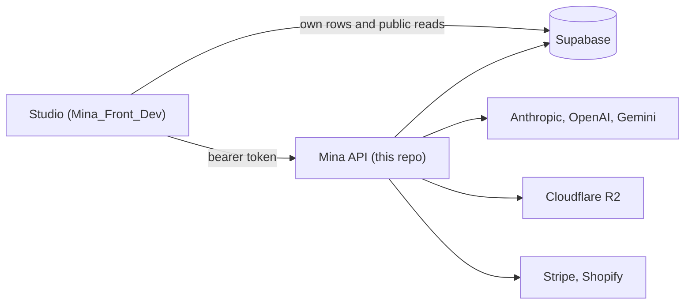

# Mina backend docs

Start here. These pages explain how the Mina API is built, so you can find your way around before you change anything.

## What Mina is

Mina is an AI image studio for designers. A user writes a brief, adds pictures (a scene, a logo, a product) or ticks saved brand memories, and Mina makes a still image from them. Every generation costs matchas, the platform's credits.

| Repo | What it is |
|---|---|
| `Mina_Back_Dev` (this one) | Express 5 + TypeScript API, ESM. Holds every secret, including the Supabase `service_role` key. |
| `Mina_Front_Dev` | React + Vite single page app, the only client. It reads and writes the user's own rows straight in Supabase, and calls this API only for work that needs a secret or server logic. Its docs live in its own `docs/` folder. |

## Run it

1. `npm install`
2. Create `.env` (see [Environment variables](#environment-variables)).
3. Start from the repo root: `npm run dev`.

| Script | Command | What it does |
|---|---|---|
| `dev` | `tsx watch --env-file=.env src/server.ts` | Runs the TypeScript source and restarts on every change. |
| `build` | `tsc` | Compiles `src/` into `dist/`. |
| `start` | `node --env-file=.env dist/server.js` | Runs the compiled build. |
| `typecheck` | `tsc --noEmit` | Type checks without writing files. |

Things to know before the first run:

- The server listens on `PORT` (3000 by default). `GET /health` answers `{"status":"ok"}`.
- Always start it from the repo root, `start` included. The knowledge guides are read from the relative path `src/server/mma/knowledge` ([`KNOWLEDGE_DIR`](../src/lib/constants.ts)), because `tsc` does not copy them into `dist`. They are read once at boot, so a missing guide stops the process right away.
- Starting the server also starts every scheduled job ([jobs.md](jobs.md)), including the credit expiry sweep and the auto-refill that charges saved cards. Check which Supabase project and which Stripe keys your `.env` points to before you run it.

## Environment variables

[`src/config/env.ts`](../src/config/env.ts) is the only file that reads `process.env`. It parses it with a zod schema when the module loads, so a missing or malformed variable crashes the process at boot rather than at the first request. [`.env.example`](../.env.example) is the committed template. Never commit `.env`.

| Variable | Used for | Rule in `env.ts` |
|---|---|---|
| `PORT` | The HTTP port. | number, default 3000 |
| `NODE_ENV` | Parsed, but no code reads it yet. | `development`, `staging` or `production`, default `development` |
| `SUPABASE_URL` | The Supabase project. | URL |
| `SUPABASE_SERVICE_ROLE_KEY` | Full database access, bypasses RLS. | required |
| `CORS_ORIGIN` | The only origin allowed by CORS, and the base of the Stripe return URLs (`/profile`). | URL |
| `STRIPE_SECRET_KEY` | Stripe API. | required |
| `STRIPE_WEBHOOK_SECRET` | Verifies the Stripe webhook signature. | required |
| `SHOPIFY_STORE_DOMAIN`, `SHOPIFY_ADMIN_TOKEN`, `SHOPIFY_API_VERSION` | Mirrors paid orders into Shopify. | required |
| `ANTHROPIC_API_KEY` | Claude, MMA steps 1 and 3. | required |
| `OPENAI_API_KEY` | GPT Image, the SEO writer and the brand memory scanner. | required |
| `GEMINI_API_KEY` | NanoBanana Pro on the niche lane. | required |
| `R2_ACCOUNT_ID`, `R2_ACCESS_KEY_ID`, `R2_SECRET_ACCESS_KEY`, `R2_BUCKET` | Writes and deletes files in Cloudflare R2. | required |
| `R2_PUBLIC_BASE_URL` | Public base URL of the bucket. Also how the API checks that a URL in a request is one of its own files. | URL |
| `PROMPT_FILE_KEY` | The AES-256 key that seals `.mina` prompt files. | 64 hex characters (32 bytes) |

Heads up: `.env.example` only lists `PORT`, `NODE_ENV`, `SUPABASE_URL`, `SUPABASE_SERVICE_ROLE_KEY` and `CORS_ORIGIN` today. Every other row above is also required by `env.ts`, so take the full list from the schema.

Adding a variable means three edits: `.env`, `.env.example` and the schema in `env.ts`.

## Glossary

| Term | Meaning |
|---|---|
| Matcha | One credit. A still costs 1 matcha on niche and creative, 2 on creative_plus ([`STILL_GENERATION_COSTS`](../src/lib/constants.ts)). Users get 3 free on first sign-in (`SIGNUP_BONUS`), buy more in packs (`MATCHA_PACKS`), and each lot expires one month after it was granted (`LOT_LIFETIME_MONTHS`). |
| Pass id | `pass:user:<supabase user id>`, the owner key on every row (`mg_pass_id`). |
| Create | The studio mode that makes a still. Its generation rows have `mg_mma_mode: "still"` and flow `still_create`. |
| MMA | The pipeline behind a Create: four steps that turn a brief and pictures into a still. Each step saves its result in an `mma_step` row. See [mma-pipeline.md](mma-pipeline.md). |
| Lanes | The studio's Create switch, sent as `lane`. `niche` renders with NanoBanana Pro in 4K. `creative` renders with GPT Image (`gpt-image-2.5-flare`) at about 2K. `creative_plus` renders with GPT Image (`gpt-image-2.5-sunburst`) at about 4K and costs 2 matchas. |
| Brand memory | A saved picture of a product, a model, a logo or an illustration. The user ticks it in the studio's "Using" pill to send it with a Create. Stored as a `product` row. See [features/brand-memory.md](features/brand-memory.md). |
| Pills | The studio's "+" pills a picture is added under: `scene`, `logo`, `product` (`UploadKind`). MMA calls them `scene`, `logo` and `featured_asset` (`PillHint`). A pill is only a hint: step 1 decides what each picture really is. The "Using" pill holds the ticked brand memories. |
| Mina brief | The short lines Mina types in the studio while a generation runs. The studio picks them from the generation's `mg_mma_status`, which the pipeline sets step by step. Not to be confused with the user's brief: the `brief` field of the request, which is what the user typed with the locked strip as its last line. |
| Prompt file | A `.mina` file that holds a generation's inputs, encrypted, so it can be reopened in any studio. See [features/prompt-files.md](features/prompt-files.md). |

## Reading order

1. [architecture.md](architecture.md): the layers and where each kind of code goes.
2. [api.md](api.md): every endpoint, its body and its response.
3. [mma-pipeline.md](mma-pipeline.md): how a Create becomes a picture. The most important page.
4. [data-model.md](data-model.md): the `mega_generations` and `mega_customers` tables as the code uses them.
5. [jobs.md](jobs.md): the scheduled work started by `server.ts`.
6. Features:
   - [features/brand-memory.md](features/brand-memory.md)
   - [features/credits-and-billing.md](features/credits-and-billing.md)
   - [features/uploads-and-r2.md](features/uploads-and-r2.md)
   - [features/prompt-files.md](features/prompt-files.md)
   - [features/soft-delete.md](features/soft-delete.md)

The rules for writing code in this repo are in [CLAUDE.md](../CLAUDE.md).
