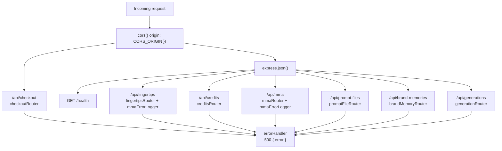

# API

Every endpoint, in the order [`app.ts`](../src/app.ts) mounts it.



## Before express.json(): the checkout router

`app.use('/api/checkout', checkoutRouter)` is mounted before `app.use(express.json())`. Stripe signs the exact bytes it sends, so the webhook route needs the raw body. A global JSON parser placed first would have consumed it. Inside the router, each route picks its own parser: `express.raw()` for the webhook, `express.json()` for `/session`.

## Auth

| Middleware | What it does | On failure |
|---|---|---|
| `requireUser` | Reads `Authorization: Bearer <token>`, verifies it with `supabase.auth.getUser`, sets `req.userId`. The user id never comes from the body. | `401 { "error": "Missing bearer token" }` or `401 { "error": "Invalid token" }` |
| `requireAdmin` | Runs after `requireUser`. Lets through only a caller whose `mega_customers.mg_role` is `admin`. | `403 { "error": "Admins only" }` |

Both live in [`auth.middleware.ts`](../src/middlewares/auth.middleware.ts).

## Errors

Anything a controller or service throws, a zod validation failure included, reaches [`errorHandler`](../src/middlewares/error.middleware.ts), which answers `500 { "error": "<message>" }`. There is no 400 for a bad body today. Routes under `/api/mma` also pass through `mmaErrorLogger`, which logs the method and file the error came from before handing it on.

## Endpoint table

| Method and path | Middlewares | Controller | Service |
|---|---|---|---|
| `GET /health` | none | inline in `app.ts` | none |
| `POST /api/checkout/webhook` | `express.raw` | `postCheckoutWebhook` | `fulfillWebhookEvent` |
| `POST /api/checkout/session` | `express.json`, `requireUser` | `postCheckoutSession` | `createCheckoutSession` |
| `POST /api/checkout/portal` | `requireUser` | `postBillingPortal` | `createBillingPortalSession` |
| `POST /api/credits/signup-bonus` | `requireUser` | `postSignupBonus` | `grantSignupBonus` |
| `POST /api/mma/still` | `requireUser` | `postStillGeneration` | `startStillGeneration` |
| `POST /api/mma/uploads` | `requireUser`, `express.raw` | `postUpload` | `storeStudioImage` |
| `DELETE /api/mma/uploads` | `requireUser` | `deleteUpload` | `deleteStudioImage` |
| `POST /api/prompt-files/export` | `requireUser` | `postPromptFileExport` | `exportPromptFile` |
| `POST /api/prompt-files/import` | `requireUser` | `postPromptFileImport` | `importPromptFile` |
| `POST /api/brand-memories` | `requireUser` | `postBrandMemory` | `createBrandMemory` |
| `POST /api/generations/:generationId/restore` | `requireUser`, `requireAdmin` | `postRestoreGeneration` | `restoreGeneration` |
| `POST /api/fingertips/tweak` | `requireUser` | `postTweak` | `startTweak` |
| `POST /api/fingertips/vectorize`, `/vectorize-all` | `requireUser` | `postVectorize`, `postVectorizeAll` | `startVectorize`, `startVectorizeAll` |
| `POST /api/fingertips/no-subject`, `/no-subject-all` | `requireUser` | `postNoSubject`, `postNoSubjectAll` | `startNoSubject`, `startNoSubjectAll` |
| `POST /api/fingertips/no-background`, `/no-background-all` | `requireUser` | `postNoBackground`, `postNoBackgroundAll` | `startNoBackground`, `startNoBackgroundAll` |
| `POST /api/fingertips/expand` | `requireUser` | `postExpand` | `startExpand` |
| `POST /api/fingertips/erase` | `requireUser` | `postErase` | `startErase` |

The sections below give each one's body and response. "R2 URL" means a string that starts with `R2_PUBLIC_BASE_URL/`: the API only accepts its own files, never a URL of the browser's choosing.

## Health

### `GET /health`

No auth. Answers `{ "status": "ok" }`.

## Checkout

Router [`checkout.routes.ts`](../src/routes/checkout.routes.ts), controller [`checkout.controller.ts`](../src/controllers/checkout.controller.ts), service [`stripe.service.ts`](../src/services/stripe.service.ts). The flow is explained in [features/credits-and-billing.md](features/credits-and-billing.md).

### `POST /api/checkout/webhook`

Called by Stripe, not by the studio. No `requireUser`.

- Body: the raw Stripe event (`express.raw({ type: 'application/json' })`).
- Header: `stripe-signature` is required, else `400 { "error": "Missing stripe-signature header" }`.
- Handles `checkout.session.completed` (a pack purchase) and `invoice.paid` when the invoice's `metadata.type` is `auto_refill`. Every other event is ignored.
- Response: `{ "received": true }`.

### `POST /api/checkout/session`

Opens a Stripe Checkout page for one matcha pack.

```json
{ "matchas": 500, "currency": "EUR" }
```

- `matchas`: positive integer. It must be one of the packs in [`MATCHA_PACKS`](../src/lib/constants.ts) (100, 500, 1500, 5000), else the service throws `Unknown matcha pack`.
- `currency`: `GBP`, `EUR`, `AED` or `USD`.
- Response: `{ "url": "https://checkout.stripe.com/..." }`.

### `POST /api/checkout/portal`

No body. Response: `{ "url": "<Stripe billing portal URL>" }`. Fails when the user has no Stripe customer yet (no purchase so far).

## Credits

Router [`credits.routes.ts`](../src/routes/credits.routes.ts), controller [`credits.controller.ts`](../src/controllers/credits.controller.ts), service [`credits.service.ts`](../src/services/credits.service.ts).

### `POST /api/credits/signup-bonus`

No body. Gives a first-time user `SIGNUP_BONUS` (3) matchas, once. Safe to call on every sign-in: the ledger is the record of who was already paid.

- Response: `{ "granted": true, "credits": 3 }`, or `{ "granted": false, "credits": <balance> }` when the bonus was already given.

## MMA

Router [`mma.routes.ts`](../src/routes/mma.routes.ts), controller [`mma/mma.controller.ts`](../src/controllers/mma/mma.controller.ts).

### `POST /api/mma/still`

Starts a Create. Service `startStillGeneration` in [`mma.service.ts`](../src/services/mma/mma.service.ts). It checks the balance, writes the rows, charges the matchas and answers at once. The four MMA steps then run in the background ([mma-pipeline.md](mma-pipeline.md)).

```json
{
  "studioSessionId": "3b0d6a52-6f9e-4c55-9a51-0f3c8e2a9d11",
  "platform": "tiktok",
  "aspectRatio": "9:16",
  "lane": "niche",
  "brief": "put my serum on the marble table\nwarm morning light",
  "uploads": [
    { "kind": "scene", "url": "<R2 URL>", "origin": "upload" }
  ],
  "brandMemories": [
    { "id": "product:9f1c2e7a-...", "name": "Aurora Serum", "category": "product", "images": ["<R2 URL>"] }
  ]
}
```

| Field | Rule |
|---|---|
| `studioSessionId` | uuid. The browser tab's studio session. A new one writes a new "Mina Studio session" row. |
| `platform` | `tiktok`, `instagram-post`, `print` or `square`. |
| `aspectRatio` | `9:16`, `16:9`, `3:4`, `4:3`, `2:3`, `3:2` or `1:1`. |
| `lane` | `niche`, `creative` or `creative_plus`. |
| `brief` | string. What the user typed, with the locked strip as its last line. |
| `uploads[]` | `kind`: `scene`, `logo` or `product`. `url`: R2 URL. `origin`: `upload` or `scene_library`. |
| `brandMemories[]` | `id`: the memory's `mg_id` (`product:<uuid>`). `name`. `category`: `logo`, `illustration`, `model` or `product`. `images`: at least one R2 URL. |

- Response: `{ "generationId": "<uuid>", "credits": <balance after the charge> }`.
- Throws `Not enough matcha` (so a 500) before writing anything when the balance is below the lane's cost.
- The studio follows the generation by reading its row's `mg_mma_status` from Supabase. There is no read endpoint here.

### `POST /api/mma/uploads`

Stores one studio picture in R2. Service `storeStudioImage` in [`mmaUploads.service.ts`](../src/services/mma/mmaUploads.service.ts).

- Body: the raw bytes of the picture, not JSON.
- Header: `Content-Type` must be `image/jpeg`, `image/png` or `image/webp` ([`UPLOAD_EXTENSIONS`](../src/lib/constants.ts)). With any other type `express.raw` leaves the body unset and the zod check fails with `Expected a JPEG, PNG or WebP picture`. The studio converts HEIC, AVIF and GIF before sending.
- Size: up to `UPLOAD_MAX_SIZE` (`48mb`).
- Response: `{ "url": "<R2_PUBLIC_BASE_URL>/mina-assets/owner_<hash>/<uuid>.jpg" }`.

### `DELETE /api/mma/uploads`

Deletes one of the caller's own uploads from R2. Service `deleteStudioImage`.

```json
{ "url": "<R2 URL>" }
```

- The key must be exactly `mina-assets/owner_<caller's hash>/<uuid>.<jpg|png|webp>`, else it throws `Not one of your uploads`.
- Response: `{ "ok": true }`.

## Prompt files

Router [`promptFile.routes.ts`](../src/routes/promptFile.routes.ts), controller [`promptFile.controller.ts`](../src/controllers/promptFile.controller.ts), service [`promptFile.service.ts`](../src/services/promptFile.service.ts). See [features/prompt-files.md](features/prompt-files.md).

### `POST /api/prompt-files/export`

```json
{ "generationId": "<uuid>" }
```

- Only the generation's owner can export it (the row is looked up by `mg_id` and `mg_pass_id`).
- Response: `{ "file": "MINA-PROMPT-FILE-1:<base64>" }`.

### `POST /api/prompt-files/import`

Any signed-in user can import.

```json
{ "file": "MINA-PROMPT-FILE-1:<base64>" }
```

- Response: the decrypted inputs.

```json
{
  "brief": "put my serum on the marble table",
  "lane": "niche",
  "platform": "tiktok",
  "aspectRatio": "9:16",
  "uploads": [{ "kind": "scene", "url": "<R2 URL>", "origin": "upload" }]
}
```

## Brand memories

Router [`brandMemory.routes.ts`](../src/routes/brandMemory.routes.ts), controller [`brandMemory.controller.ts`](../src/controllers/brandMemory.controller.ts), service [`brandMemory.service.ts`](../src/services/brandMemory.service.ts). See [features/brand-memory.md](features/brand-memory.md).

### `POST /api/brand-memories`

Saves pictures already uploaded to R2 as one new brand memory, after a gpt-4o-mini scan of the first one.

```json
{ "urls": ["<R2 URL>", "<R2 URL>"], "sort_order": 12 }
```

- `urls`: 1 to `BRAND_MEMORY_MAX_IMAGES` (5) R2 URLs. The first is the cover and the one scanned.
- `sort_order`: number. The frontend numbers it before uploading, so memories added together keep their places.
- Throws when the user already has `BRAND_MEMORY_MAX` (1000) memories.
- Response: `{ "id": "<uuid>" }`. The row's `mg_id` is `product:<uuid>`.

Listing, editing and deleting a memory's row happen in the frontend, straight in Supabase.

## Generations

Router [`generation.routes.ts`](../src/routes/generation.routes.ts), controller [`generation.controller.ts`](../src/controllers/generation.controller.ts), service [`generations.service.ts`](../src/services/generations.service.ts). See [features/soft-delete.md](features/soft-delete.md).

### `POST /api/generations/:generationId/restore`

Admins only. Brings back a generation a user deleted, while it is still inside the 30-day window.

- Params: `generationId` must be a uuid.
- No body.
- Throws when the row does not exist, is not deleted, or was deleted more than `GENERATION_PURGE_DAYS` (30) days ago.
- Response: `{ "restored": "<generationId>" }`.

## Fingertips

Router [`fingertips.routes.ts`](../src/routes/fingertips.routes.ts), controller [`fingertips.controller.ts`](../src/controllers/fingertips.controller.ts), services in [`services/fingertips/`](../src/services/fingertips/). Like `/api/mma`, these routes pass through `mmaErrorLogger`. The whole flow is in [features/fingertips.md](features/fingertips.md).

Every route takes the same base body:

```json
{
  "imageUrl": "<R2 URL>",
  "lane": "niche",
  "aspectRatio": "9:16",
  "platform": "tiktok"
}
```

| Field | Rule |
|---|---|
| `imageUrl` | R2 URL. The picture to edit. |
| `lane` | `niche`, `creative` or `creative_plus`. Prices and renders a Tweak; the other tools only carry it. |
| `aspectRatio` | `9:16`, `16:9`, `3:4`, `4:3`, `2:3`, `3:2` or `1:1`. Used for the SEO, except on `/expand`, where it is the ratio to expand to. |
| `platform` | `tiktok`, `instagram-post`, `print` or `square`. For the SEO. |

What each route adds or changes:

| Route | Body | Response |
|---|---|---|
| `/tweak` | adds `brief`: the user's note, at least 4 characters after trimming | `{ generationId, credits }` |
| `/vectorize`, `/no-subject`, `/no-background`, `/expand` | the base body | `{ generationId, credits }` |
| `/vectorize-all`, `/no-subject-all`, `/no-background-all` | `imageUrls` (at least one R2 URL) instead of `imageUrl` | `{ generationIds: [...], credits }` |
| `/erase` | adds `mask`: a PNG data URL starting with `data:image/png;base64,` (white is erased, black is kept) | `{ generationId, credits }` |

- Each throws `Not enough matcha` before writing anything when the balance is below the price.
- `credits` is the balance after the charge. The edit itself runs in the background. The studio follows its row's `mg_mma_status` in Supabase, as for a Create.
- `/erase`'s body goes through the global `express.json()`, which accepts up to 100 KB. A black and white mask is far below that.
