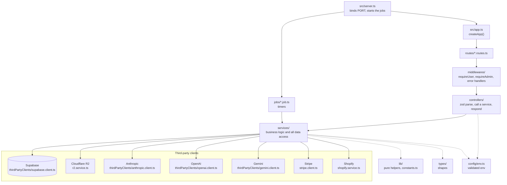

# Architecture

How a request travels through the code, and where each kind of code lives.

## The request path

| Layer | Files | Job |
|---|---|---|
| Entry | [`server.ts`](../src/server.ts) | Calls `createApp().listen(env.PORT)`, then starts the six job schedulers. |
| App | [`app.ts`](../src/app.ts) | `createApp()` adds CORS, mounts the routers and registers `errorHandler` last. It opens no socket and starts no timer, so tests can import it. |
| Routes | [`routes/`](../src/routes) | One `Router` per domain. Maps a path to its middlewares and its controller. |
| Middlewares | [`auth.middleware.ts`](../src/middlewares/auth.middleware.ts), [`error.middleware.ts`](../src/middlewares/error.middleware.ts) | `requireUser` turns the bearer token into `req.userId`. `requireAdmin` checks `mega_customers.mg_role`. `mmaErrorLogger` logs MMA errors. `errorHandler` turns any thrown error into `500 { "error": message }`. |
| Controllers | [`controllers/`](../src/controllers) | One handler per endpoint. Parses the body with zod, calls one service, sends the JSON. |
| Services | [`services/`](../src/services) | Business logic and every Supabase, R2 and AI call. Take and return plain data, never `req` or `res`. |
| Clients | [`services/thirdPartyClients/`](../src/services/thirdPartyClients), [`stripe.client.ts`](../src/services/stripe.client.ts), [`r2.service.ts`](../src/services/r2.service.ts) | The one place each outside service is called. |

The full endpoint list is in [api.md](api.md).

## Third-party clients

| Service | File | How it is called |
|---|---|---|
| Supabase | [`supabase.client.ts`](../src/services/thirdPartyClients/supabase.client.ts) | `@supabase/supabase-js` with the `service_role` key, so it bypasses RLS. No session is kept between requests. |
| Anthropic | [`anthropic.client.ts`](../src/services/thirdPartyClients/anthropic.client.ts) | `askClaude()` wraps `@anthropic-ai/sdk` and returns the message with its usage, cache and routing details for the step payloads. |
| OpenAI | [`openai.client.ts`](../src/services/thirdPartyClients/openai.client.ts) | Plain `fetch`. `openAiImage()` for GPT Image, `openAiJson()` for the SEO writer, `openAiImageTool()` for the brand memory scanner. |
| Gemini | [`gemini.client.ts`](../src/services/thirdPartyClients/gemini.client.ts) | Plain `fetch`. `geminiImage()` for NanoBanana Pro. |
| Stripe | [`stripe.client.ts`](../src/services/stripe.client.ts) | The `stripe` SDK. Used only by [`stripe.service.ts`](../src/services/stripe.service.ts). |
| Cloudflare R2 | [`r2.service.ts`](../src/services/r2.service.ts) | Plain `fetch` with a hand-signed AWS SigV4 header. `putObject()` and `deleteObject()`. |
| Shopify | [`shopify.service.ts`](../src/services/shopify.service.ts) | Plain `fetch` to the Admin GraphQL API. `recordShopifyOrder()` mirrors each paid order. |
| Exchange rates | [`mmaCostRates.service.ts`](../src/services/mma/mmaCostRates.service.ts), [`stripe.service.ts`](../src/services/stripe.service.ts) | Plain `fetch` to `open.er-api.com` for GBP rates. |

## Services by domain

| Service | Owns |
|---|---|
| [`mma/mma.service.ts`](../src/services/mma/mma.service.ts) | Starting a Create and running its pipeline. See [mma-pipeline.md](mma-pipeline.md). |
| [`mma/mmaStep1/`](../src/services/mma/mmaStep1) to [`mma/mmaStep4/`](../src/services/mma/mmaStep4), [`mmaSeo.service.ts`](../src/services/mma/mmaSeo.service.ts) | One file per pipeline step. |
| [`mma/mmaCostRates.service.ts`](../src/services/mma/mmaCostRates.service.ts) | The in-memory exchange rate and monthly volume used to price `mg_cost_data`. |
| [`mma/mmaUploads.service.ts`](../src/services/mma/mmaUploads.service.ts) | Studio uploads in R2. |
| [`mma/mmaErrorLogger.service.ts`](../src/services/mma/mmaErrorLogger.service.ts) | `logMmaError()`: logs an error with the method and file of ours it came from. |
| [`credits.service.ts`](../src/services/credits.service.ts) | The matcha ledger: signup bonus, purchases, refunds, expiry. |
| [`stripe.service.ts`](../src/services/stripe.service.ts) | Checkout, billing portal, webhook, auto-refill charges. |
| [`autoRefill.service.ts`](../src/services/autoRefill.service.ts) | The auto-refill scan. |
| [`customers.service.ts`](../src/services/customers.service.ts) | Small `mega_customers` reads and writes (Stripe ids, preferences). |
| [`brandMemory.service.ts`](../src/services/brandMemory.service.ts) | Creating, using and expiring brand memories. |
| [`generations.service.ts`](../src/services/generations.service.ts) | Purging and restoring deleted generations. |
| [`promptFile.service.ts`](../src/services/promptFile.service.ts) | Exporting and importing `.mina` files. |

## lib, types and config

- [`lib/`](../src/lib) holds pure functions with no I/O and no Express import, grouped by subject: [`clock.ts`](../src/lib/clock.ts), [`date.ts`](../src/lib/date.ts), [`promptFile.ts`](../src/lib/promptFile.ts), and one folder per MMA step (`mmaStep1/` to `mmaStep4/`, `mmaSeo/`, `mmaCost/`, `mmaVars/`, `brandMemory/`). The long Claude prompts and tool schemas live there as constants.
- [`lib/constants.ts`](../src/lib/constants.ts) holds every value the app leans on: costs, models and their settings, prices, hours, the time zone, R2 folders, limits. Look there first when you need a number.
- [`types/`](../src/types) holds every shape: request and response bodies, row payloads, the MMA types in [`types/mma/mma.types.ts`](../src/types/mma/mma.types.ts). Shared models are kept identical to the frontend's `types/`.
- [`config/env.ts`](../src/config/env.ts) is the only reader of `process.env`. See [README.md](README.md#environment-variables).

## Where jobs plug in

[`server.ts`](../src/server.ts) starts the schedulers right after `listen()`. They are never started in `app.ts`, so importing the app starts no timer. A job calls services directly, exactly as a controller would, and never calls this API over HTTP. Details in [jobs.md](jobs.md).

## Layer rules

Summarised from [CLAUDE.md](../CLAUDE.md):

- The flow is always `route -> middleware -> controller -> service -> Supabase`. Never skip a layer and never import backwards (a service never imports a controller).
- Controllers parse, delegate and respond. No business logic, no Supabase calls.
- Services hold the logic and all data access. They never see `req` or `res`.
- Every constant goes in `lib/constants.ts`, and every named helper goes in a `lib/` file by subject.
- Only `config/env.ts` reads `process.env`.
- Services throw. The global `errorHandler`, registered last in `app.ts`, formats the response. Express 5 forwards a rejected async handler to it by itself.
- Relative ESM imports end in `.js`, and there is no path alias.
- Write the least code possible: reuse what exists, no wrapper or abstraction without a second caller.
- No new dependency without asking. Today the runtime ones are `express`, `cors`, `zod`, `@supabase/supabase-js`, `@anthropic-ai/sdk` and `stripe`.
- New endpoints are built bottom-up: types, service, controller, route, then mount in `app.ts`.

One known exception: `requireAdmin` in [`auth.middleware.ts`](../src/middlewares/auth.middleware.ts) reads `mega_customers` through the Supabase client itself instead of going through a service.
