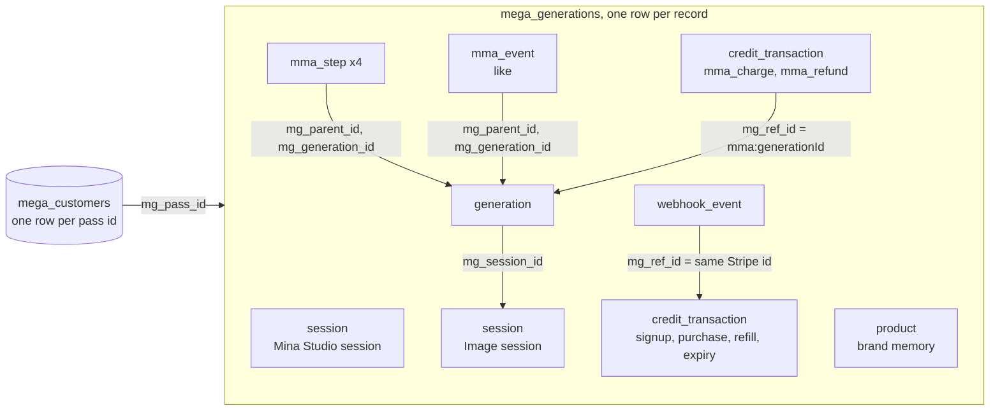

# Data model

Two Supabase tables carry everything: `mega_generations`, one ledger for every kind of record, and `mega_customers`, one row per user. This page describes only what the code reads and writes. It is not a dump of the live schema.




## mega_generations record types

| `mg_record_type` | `mg_id` | Written by | Read or deleted by |
|---|---|---|---|
| `generation` | `generation:<generationId>` | `startStillGeneration`, then `runStillPipeline` | the studio, `exportPromptFile`, `purgeDeletedGenerations`, `restoreGeneration`, `refreshGenerationsPerMonth` |
| `mma_step` | `mma_step:<generationId>:<n>`, n from 1 to 4 | `startStillGeneration` (step 1 skeleton), `runStillPipeline` | `purgeDeletedGenerations` |
| `session` | `session:<sessionId>` | `startStillGeneration` | `startStillGeneration` (has this tab been seen?), `purgeDeletedGenerations` |
| `product` (brand memory) | `product:<uuid>` | `createBrandMemory` | `createBrandMemory` (the 1000 cap), `saveUsedUploadsAsBrandMemories`, `markBrandMemoriesUsed`, the brand memory sweep, and the frontend for listing and editing |
| `credit_transaction` | `credit_transaction:<uuid>` | `recordTransaction` in [`credits.service.ts`](../src/services/credits.service.ts) | the idempotency checks in `credits.service.ts`, `purgeDeletedGenerations` |
| `webhook_event` | `webhook_event:stripe_<ms>_<uuid>` | `applyCreditFulfillment` in `credits.service.ts` | nothing in this backend |
| `mma_event` (like) | `mma_event:<uuid>` | the frontend, straight in Supabase | `purgeDeletedGenerations` |

## Columns, record by record

### generation

| Column | Value |
|---|---|
| `mg_generation_id` | the generation's uuid |
| `mg_session_id` | the image session's id |
| `mg_mma_mode` | `still`. An edit tool's generation has `fingertips` instead, with a few columns that differ: see [features/fingertips.md](features/fingertips.md#the-generation-row). |
| `mg_status` | `progressing`, then `done` or `error`. `deleted` once the user deletes it. |
| `mg_mma_status` | `progressing`, `scanning`, `prompting`, `generating`, then `done` or `error`. `deleted` once the user deletes it. See [mma-pipeline.md](mma-pipeline.md#status-the-studio-polls). |
| `mg_prompt` | empty, then step 3's `clean_prompt` |
| `mg_output_url` | empty, then the still's R2 URL |
| `mg_meta` | `{}`, then `{ seo, provenance }` |
| `mg_cost_data` | `{}`, then the cost breakdown ([mma-pipeline.md](mma-pipeline.md#cost-data)) |
| `mg_mma_vars` | `{}`, then the run's inputs and results ([mma-pipeline.md](mma-pipeline.md#final-mg_mma_vars)) |
| `mg_error` | `{ code, message }` on failure |
| `mg_platform`, `mg_title` | the request's platform, `Image session` |
| `mg_type`, `mg_content_type` | `image` |
| `deleted_since` | set by the frontend when the user deletes it, cleared by a restore. See [features/soft-delete.md](features/soft-delete.md). |

### mma_step

| Column | Value |
|---|---|
| `mg_generation_id` | the generation's uuid |
| `mg_parent_id` | `generation:<generationId>` |
| `mg_step_no` | 1 to 4 |
| `mg_step_type` | `create_asset_intelligence`, `knowledge_files`, `gpt_still_one_shot`, then `nanobanana_generate` or `gpt_image_2_generate` |
| `mg_payload` | the step's whole input, output, usage and timing |

### session

| Column | Mina Studio session | Image session |
|---|---|---|
| `mg_session_id` (and `mg_id` after `session:`) | the studio's `studioSessionId` | a new uuid per Create |
| `mg_title` | `Mina Studio session` | `Image session` |
| `mg_meta` | `{ ip, requestId: "sess_<ms>_<uuid>", userAgent }` | `{ flow: "still_create", source: "mma" }` |
| `mg_status` | `succeeded` | `succeeded` |
| `mg_platform`, `mg_event_at` | the request's platform, the request time | same |

The generation points to its image session through `mg_session_id`. No column links an image session to the studio session it came from.

### credit_transaction

Common columns: `mg_delta` (signed amount), `mg_reason`, `mg_ref_type`, `mg_ref_id`, `mg_source`, `mg_status: "succeeded"`, `mg_event_at`, and `mg_meta: { expires_at, credits_after, credits_before }`.

| What | `mg_reason` | `mg_ref_type` | `mg_ref_id` | `mg_source` | `mg_delta` |
|---|---|---|---|---|---|
| Signup bonus | `free_signup` | `free_signup` | the pass id | `system` | +3 |
| Pack purchase | `stripe-checkout` | `stripe_checkout` | the Checkout session id | `stripe` | + pack size |
| Auto-refill | `stripe-auto-refill` | `stripe_auto_refill` | the Stripe invoice id | `stripe` | + pack size |
| Create charge | `mma_still_<lane>` | `mma_charge` | `mma:<generationId>` | `mma` | minus the lane cost |
| Create refund | `mma_refund` | `mma_refund` | `mma:<generationId>` | `mma` | + the lane cost |
| Edit tool charge | `fingertips_pool_draw` | `fingertips_charge` | `fingertips:<generationId>` | `fingertips` | minus the tool's price |
| Edit tool refund | `fingertips_refund` | `fingertips_refund` | `fingertips:<generationId>` | `fingertips` | + the tool's price |
| Expiry | `expired` | `expiration` | `exp_<passId>_<ISO time>` | `system` | minus the whole balance |

`(mg_ref_type, mg_ref_id)` is what makes a purchase, refill or refund happen only once: each function looks for an existing row with that pair before writing. The signup bonus looks for a `free_signup` row of the same pass id instead. The rules are in [features/credits-and-billing.md](features/credits-and-billing.md).

### webhook_event

Written right after a purchase or refill transaction, dated 500 ms after it.

| Column | Value |
|---|---|
| `mg_status`, `mg_source` | `succeeded`, `stripe` |
| `mg_ref_type`, `mg_ref_id` | same as the transaction it follows |
| `mg_meta` | `{ email, balance, credited, event_type, request_id }` plus `session_id` (purchase) or `invoice_id` (refill) |

### product (brand memory)

| Column | Value |
|---|---|
| `mg_generation_id` | the memory's uuid (the same as in its `mg_id`) |
| `mg_mma_mode` | `product` |
| `mg_status`, `mg_mma_status` | `done`, or `error` when the scan failed (the profile does not list those) |
| `mg_type`, `mg_content_type` | `image` |
| `mg_output_url` | the cover picture |
| `mg_prompt` | the scanned name |
| `mg_mma_vars` | `BrandMemoryVars`, below |

`mg_mma_vars` of a brand memory, typed by `BrandMemoryVars` in [`types/brandMemory.types.ts`](../src/types/brandMemory.types.ts) and built by `brandMemoryVars()` in [`brandMemoryLib.ts`](../src/lib/brandMemory/brandMemoryLib.ts). The type is kept identical to the frontend's.

```json
{
  "kind": "product",
  "name": "Aurora Serum",
  "description": "A tall frosted glass dropper bottle with a gold cap ...",
  "tags": ["serum", "glass", "dropper", "gold"],
  "aliases": ["aurora", "gold cap serum"],
  "category": "product",
  "images": ["<R2>/mina-assets/owner_<hash>/<uuid>.png"],
  "origin": "create",
  "source_upload_url": "<R2>/mina-assets/owner_<hash>/<other uuid>.png",
  "scanning": true,
  "thumb_url": "<R2>/mina-assets/owner_<hash>/<uuid>.png",
  "use_count": 1,
  "sort_order": 13,
  "asset_items": [
    {
      "url": "<R2>/mina-assets/owner_<hash>/<uuid>.png",
      "roles": ["product", "frame_reference"],
      "origin": "create",
      "aliases": ["<same url>"],
      "has_face": false,
      "has_person": false
    }
  ],
  "source_urls": ["<R2>/mina-assets/owner_<hash>/<uuid>.png"],
  "last_used_at": "2026-11-06T09:00:16.004Z",
  "memory_enabled": true
}
```

| Field | Meaning |
|---|---|
| `kind`, `name`, `description`, `tags`, `aliases`, `category` | The gpt-4o-mini scan of the first picture. Empty, with `kind` and `category` `product`, when the scan failed. |
| `images` | The pictures, the first being the cover. `thumb_url`, `source_urls` and `asset_items` follow it. |
| `origin` | `upload` when made from the profile, `create` when saved from a Create's upload. |
| `source_upload_url` | Only on `create`: the upload it was copied from, so the same upload is never saved twice. |
| `scanning` | `true` when the scan succeeded (`scan !== null`). |
| `use_count`, `last_used_at` | Counted by `markBrandMemoriesUsed`. A new memory starts at 0 (`upload`) or 1 (`create`), with `last_used_at` set to its creation time. |
| `sort_order` | Its place in the studio's bar. |
| `memory_enabled` | Whether Mina reads it when creating. `true` at creation. |

### mma_event (like)

The backend never writes one. The studio inserts a like as `mma_event:<uuid>` with `mg_generation_id`, `mg_parent_id: "generation:<generationId>"` and `mg_meta: { event_type: "like", payload: { url, result_type } }`. The backend only deletes them, with their generation, in the purge.

## mega_customers

One row per user, keyed by `mg_pass_id`. The backend never inserts it: the frontend creates it on first sign-in, and every service here throws `No mega_customers row for <passId>` when it is missing.

| Column | Read or written by | Holds |
|---|---|---|
| `mg_pass_id` | everything | `pass:user:<userId>` |
| `mg_credits` | credits, MMA charge, refund, expiry, auto-refill | The matcha balance. |
| `mg_credit_lots` | credits, refund, expiry | `CreditLot[]`: `{ amount, ref_id, ref_type, created_at, expires_at }` per grant. |
| `mg_expires_at` | credits, expiry | When the whole balance expires: the latest lot's expiry. Null after a sweep. |
| `mg_role` | `requireAdmin` | `admin` lets a caller through the admin routes. |
| `mg_email` | `applyCreditFulfillment`, `recordShopifyOrder` | Copied into `webhook_event` rows and sent to Shopify. |
| `mg_mma_preferences` | auto-refill | `MmaPreferences` in [`types/customer.types.ts`](../src/types/customer.types.ts): `{ autoRefill: { enabled, qty, currency, threshold, monthlyCount, monthlyLimit, monthlyResetAt, monthlyLimitAmount } }`. |
| `mg_mma_preferences_updated_at` | `updateMmaPreferences` | When the preferences last changed. |
| `mg_stripe_customer_id`, `mg_stripe_payment_method_id` | checkout webhook, auto-refill, billing portal | The saved card used for auto-refill. |
| `mg_shopify_customer_id` | `recordShopifyOrder` | The Shopify customer id, without its `gid://` prefix. |
| `mg_updated_at` | every write | |

The credit columns are explained in [features/credits-and-billing.md](features/credits-and-billing.md).
