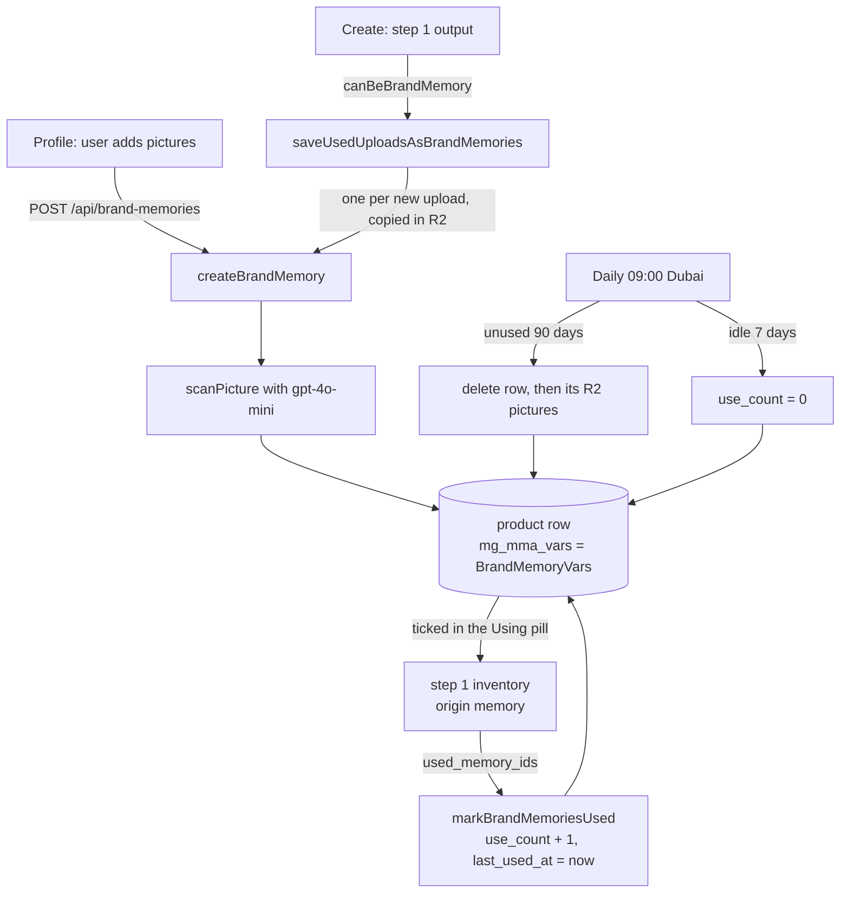

# Brand memory

Saved pictures of a brand's products, models, logos and illustrations, which the user can send with any Create. Each one is a `product` row in `mega_generations`.

Code: [`brandMemory.service.ts`](../../src/services/brandMemory.service.ts), [`brandMemoryLib.ts`](../../src/lib/brandMemory/brandMemoryLib.ts), [`brandMemory.types.ts`](../../src/types/brandMemory.types.ts), [`brandMemory.job.ts`](../../src/jobs/brandMemory.job.ts). The row's shape is in [data-model.md](../data-model.md#product-brand-memory).

## Create from the profile

The profile uploads each picture first (`POST /api/mma/uploads`), then calls `POST /api/brand-memories` with up to 5 R2 URLs and a `sort_order`. `createBrandMemory(userId, urls, sortOrder)`:

1. Counts the user's `product` rows and throws once they reach `BRAND_MEMORY_MAX` (1000).
2. Scans the first URL, the cover.
3. Inserts `product:<uuid>` with `mg_status` and `mg_mma_status` `done`, or `error` when the scan failed. A failed scan still writes the row. The profile does not list `error` rows.
4. Returns `{ id }`.

Memories from the profile have `origin: "upload"` and start with `use_count: 0`.

Listing, editing and deleting a memory's row happen in the frontend, straight in Supabase. The service's comments describe a profile delete as the row first, then each picture through `deleteStudioImage` (`DELETE /api/mma/uploads`).

## The scan

`scanPicture()` sends the cover to `gpt-4o-mini` (`BRAND_MEMORY_SCANNER`) through `openAiImageTool()`:

- The picture goes as its Cloudflare-resized URL (`cdnImage(..., 'product')`), the same way MMA reads pictures.
- The system prompt is `BRAND_MEMORY_SCANNER_PROMPT`. It tells the model to decide first whether the subject is a product, a model or a flat design.
- The model must answer through the `save_brand_memory` tool (`BRAND_MEMORY_SCAN_TOOL`, strict), which returns `{ kind, name, description, tags, aliases, category }`.
- `category` is `logo`, `illustration`, `model` or `product`. The user can change it later.
- A failed call is logged and returns null. The memory is then saved with an empty reading.

## Saving a Create's uploads

After step 1 of a Create, the pipeline picks the uploads that can become memories with `canBeBrandMemory()` (rules in [mma-pipeline.md](../mma-pipeline.md#background-work-after-step-1)) and calls `saveUsedUploadsAsBrandMemories(userId, urls)` without waiting for it.

1. Reads every brand memory of the user.
2. Skips any URL already saved: a memory's `source_upload_url` is the upload it came from, so the same upload sent again in a later Create is not saved twice.
3. Stops at the room left under the 1000 cap.
4. Gives each new memory its place after the highest `sort_order`, before any scan starts, so each keeps its place whichever scan ends first.
5. Calls `createBrandMemory(userId, [url], sortOrder, url)` for all of them at once. A failed one is logged and the others are saved anyway.

With a `sourceUploadUrl`, `createBrandMemory` copies the picture into a new R2 file with `copyStudioImage()`. Deleting the memory later then never deletes the picture the generation used. These memories have `origin: "create"`, `source_upload_url` set, and `use_count: 1`, since that Create used them.

## Using a memory in a Create

The studio sends ticked memories in `brandMemories` (`id` is the `mg_id`, plus `name`, `category` and `images`). Step 1 adds every picture of every memory to its inventory with `origin: "memory"` and `memory_id`. After step 1:

- `markBrandMemoriesUsed(userId, used_memory_ids)` adds 1 to `use_count` and sets `last_used_at` to now for each memory Claude used. Nobody waits for it.
- `unused_memory_ids` ends up in `mg_mma_vars.meta.product_memory_resolution`, where the studio reads it.

The categories of the memories in use also change which uploads are saved: an upload read as a person is not saved while a `model` memory is in use, and a logo or design is not saved while a `logo` or `illustration` memory is in use.

## Sweep and expiry

Every day at 09:00 Dubai time (`BRAND_MEMORY_EXPIRY_HOUR`), the job runs, in this order:

| Step | Rule | Effect |
|---|---|---|
| `sweepExpiredBrandMemories` | `last_used_at` older than `BRAND_MEMORY_EXPIRY_DAYS` (90) | Deletes the row, then each picture in `images` through `deleteStudioImage`. A picture that fails is logged and left. |
| `resetIdleUseCounts` | `last_used_at` older than `BRAND_MEMORY_USE_COUNT_RESET_DAYS` (7), `use_count` not 0 | Sets `use_count` back to 0. |

Unlike a deleted generation, an expired memory does lose its pictures from R2. Memories saved from a Create only hold their own copies, so the generation's pictures are safe. See [jobs.md](../jobs.md#brand-memory-sweep).
