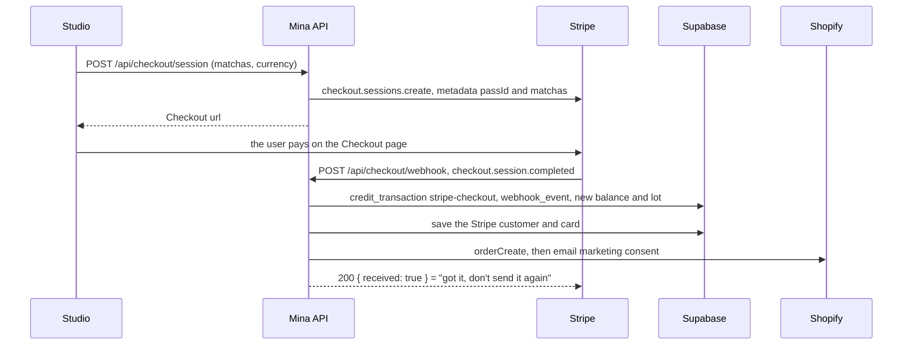
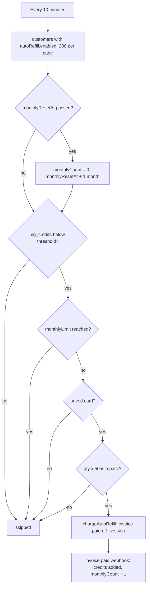

# Credits and billing

How matchas are granted, bought, spent, refunded and expired. Every change to a balance writes a `credit_transaction` row in `mega_generations` and updates `mega_customers`.

Code: [`credits.service.ts`](../../src/services/credits.service.ts), [`stripe.service.ts`](../../src/services/stripe.service.ts), [`autoRefill.service.ts`](../../src/services/autoRefill.service.ts), [`customers.service.ts`](../../src/services/customers.service.ts), [`shopify.service.ts`](../../src/services/shopify.service.ts). Settings in [`lib/constants.ts`](../../src/lib/constants.ts).

## Balance, lots and expiry

| Column on `mega_customers` | Meaning |
|---|---|
| `mg_credits` | The balance. The only thing a Create charge or a refund changes, besides the lots. |
| `mg_credit_lots` | One `CreditLot` per grant: `{ amount, ref_id, ref_type, created_at, expires_at }`. |
| `mg_expires_at` | When the whole balance expires. |

- Every grant (signup, purchase, auto-refill) creates a lot that expires `LOT_LIFETIME_MONTHS` (1) after it was granted. A purchase or a refill moves `mg_expires_at` to the later of the old date and the new lot's.
- Spending only lowers `mg_credits`. Lots are a record of what was granted, not a live split of the balance.
- A refund adds a lot that keeps the current `mg_expires_at`.
- The daily credit expiry job (08:00 Dubai) zeroes the whole balance of every customer whose `mg_expires_at` has passed, writes an `expired` transaction, and clears the lots and the date. See [jobs.md](../jobs.md#credit-expiry).

So in practice, any purchase pushes the expiry of the whole balance one month forward.

## Signup bonus

`POST /api/credits/signup-bonus` calls `grantSignupBonus()`. If the ledger already has a `free_signup` transaction for this pass id, nothing happens and it returns `{ granted: false }`. Otherwise it writes the transaction (+3, `SIGNUP_BONUS`) and sets the balance, `mg_expires_at` and `mg_credit_lots` to that one lot.

## Packs and prices

[`MATCHA_PACKS`](../../src/lib/constants.ts), priced in GBP and kept in step with the frontend's copy:

| Matchas | GBP |
|---|---|
| 100 | 60 |
| 500 | 300 |
| 1500 | 900 |
| 5000 | 2500 |

A checkout in EUR, AED or USD is converted at the moment of the request: `rateFromGbp()` fetches today's rate from `open.er-api.com`, and the amount is `round(gbp * rate * 100)` in the currency's minor unit.

## Checkout

`createCheckoutSession(userId, matchas, currency)`:

- refuses a `matchas` that is not a pack;
- reuses the user's Stripe customer when `mg_stripe_customer_id` is set, else asks Stripe to create one;
- sets `setup_future_usage: "off_session"` so the card can be charged later by auto-refill, and `invoice_creation` so each purchase gets a Stripe invoice;
- puts `{ passId, matchas }` in the session's `metadata`, the only way the webhook knows who paid for what;
- returns to `CORS_ORIGIN/profile?purchase=success` or `?purchase=cancelled`.

`POST /api/checkout/portal` returns a Stripe billing portal link for the user's invoices, and fails when there is no Stripe customer yet.

## The webhook

`fulfillWebhookEvent(rawBody, signature)` verifies the signature with `STRIPE_WEBHOOK_SECRET` (hence the raw body, see [api.md](../api.md#before-expressjson-the-checkout-router)), then:

| Event | Handler | Does |
|---|---|---|
| `checkout.session.completed` | `handleCheckoutSessionCompleted` | `addPurchasedCredits`, then saves the Stripe customer and payment method on the customer (`saveStripeCard`), then mirrors the order to Shopify. |
| `invoice.paid` with `metadata.type: "auto_refill"` | `handleAutoRefillInvoicePaid` | `addAutoRefillCredits` (which also adds 1 to `autoRefill.monthlyCount`), then mirrors the order to Shopify. |
| anything else | none | Ignored. Checkout's own invoices also fire `invoice.paid`, but carry no `auto_refill` metadata. |

Both credit functions share `applyCreditFulfillment()`. It first looks for a `credit_transaction` with the same `mg_ref_type` and `mg_ref_id` (the session or invoice id). If one exists, nothing is credited again, so Stripe can retry a delivery safely. Otherwise it writes the transaction, a `webhook_event` row, and the new balance, lot and expiry. The Shopify order is only recorded on the first delivery.

`recordShopifyOrder()` never throws: a Shopify failure is only logged. It creates a paid order under the Mina account's email (not the email typed on the card form), marks Stripe test-mode payments as `test` with a `fake` tag, stores the Shopify customer id in `mg_shopify_customer_id`, and subscribes the customer to email marketing.

## Auto-refill

The user turns it on in the frontend, which writes `mg_mma_preferences.autoRefill`. The job checks every 10 minutes.

- `qty` counts units of 50 matchas, so 2 is the 100 pack, 10 the 500 pack, 30 the 1500 pack and 100 the 5000 pack.
- `monthlyLimit: null` means no cap.
- The card is the one saved by the last Checkout purchase (`saveStripeCard` runs on every completed checkout). A customer who never bought is skipped until they do.
- `chargeAutoRefill()` creates a Stripe invoice (`metadata: { type: "auto_refill", passId, matchas }`) with one item, and pays it off-session with the saved card. The price is the pack's GBP price converted to the preference's `currency`.
- A declined charge is logged and counted as `failed`. There is no backoff and no auto-disable: the next cycle tries again while auto-refill stays on.

## Refunds

When a Create fails, `failGeneration()` calls `refundMmaCharge(passId, generationId, cost)` before anything else. It looks for a `credit_transaction` with `mg_ref_type: "mma_refund"` and `mg_ref_id: "mma:<generationId>"`. If none exists, it writes one (+cost, `mg_source: "mma"`), raises `mg_credits` and appends a lot that keeps the current expiry. A generation can only be refunded once. See [mma-pipeline.md](../mma-pipeline.md#fail-and-refund).

## Ledger summary

| Event | `mg_reason` | `mg_ref_type` | `mg_ref_id` | `mg_delta` |
|---|---|---|---|---|
| Signup bonus | `free_signup` | `free_signup` | pass id | +3 |
| Pack purchase | `stripe-checkout` | `stripe_checkout` | Checkout session id | + pack |
| Auto-refill | `stripe-auto-refill` | `stripe_auto_refill` | invoice id | + pack |
| Create charge | `mma_still_<lane>` | `mma_charge` | `mma:<generationId>` | minus the lane cost |
| Create refund | `mma_refund` | `mma_refund` | `mma:<generationId>` | + the lane cost |
| Expiry | `expired` | `expiration` | `exp_<passId>_<ISO time>` | minus the balance |
