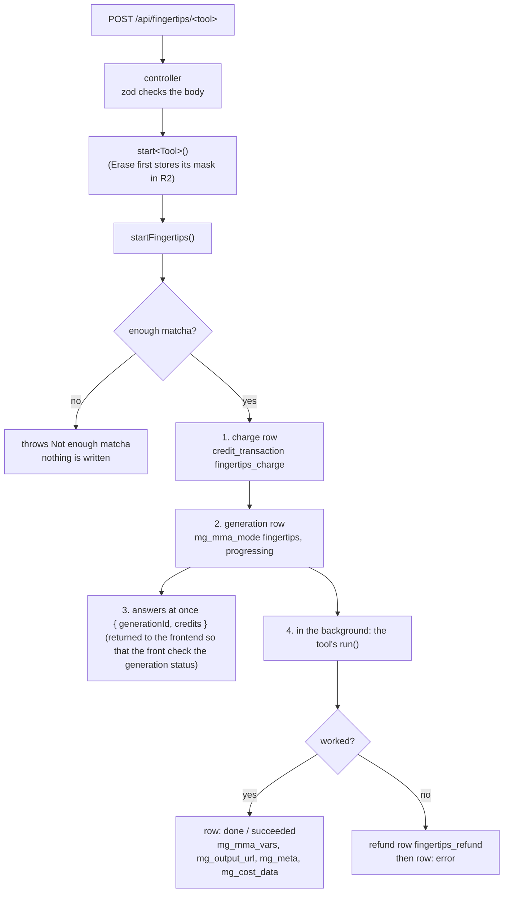

# Fingertips (edit tools)

"Fingertips" are the studio's **edit tools**: they take a picture the user already has in the studio's right panel and change it. Each edit is a new generation of its own, charged in matchas, with its own row in `mega_generations` and its own picture in R2. The original picture is never changed.

| Tool in the studio | `FingertipsTool` (`modelKey`) | Route | What it does | Done by | Price |
|---|---|---|---|---|---|
| Prompt → **Tweak** | `tweak` | `POST /api/fingertips/tweak` | Changes the picture the way the user's note asks. | Claude writes the edit prompt, then the lane's engine (NanoBanana or GPT Image) renders it | the lane's price, as a Create |
| **SVG** | `vectorize` | `/vectorize`, `/vectorize-all` | Turns the picture into an SVG vector file. | Recraft on **Replicate** | 0.1 matcha |
| **No Subject** | `no_subject` | `/no-subject`, `/no-subject-all` | Erases the main subject and fills its place. | **Bria** `erase_foreground` | 0.1 matcha |
| **No Background** | `no_background` | `/no-background`, `/no-background-all` | Cuts the subject out on a transparent background. | **Bria** `remove_background` | 0.1 matcha |
| **Expand** | `expand` | `/expand` | Grows the picture to a new ratio, inventing what was outside it. | **Bria** `expand` | 0.1 matcha |
| **Erase** | `eraser` | `/erase` | Erases the areas the user drew and fills their place. | **Bria** `erase` | 0.2 matcha |

The `-all` routes run the same tool on every picture of the panel, one generation each.

Code:
- Shared flow: [`fingertips.service.ts`](../../src/services/fingertips/fingertips.service.ts)
- One service per tool, in [`src/services/fingertips/`](../../src/services/fingertips/): `fingertipsTweak`, `fingertipsVectorize`, `fingertipsNoSubject`, `fingertipsNoBackground`, `fingertipsExpand`, `fingertipsErase`
- Helpers: [`fingertipsLib.ts`](../../src/lib/fingertips/fingertipsLib.ts)
- Types: [`fingertips.types.ts`](../../src/types/fingertips.types.ts)
- Prices and models: the `FINGERTIPS_*`, `VECTORIZE`, `NO_SUBJECT`, `NO_BACKGROUND`, `EXPAND`, `ERASE` and `TWEAK_PROMPTER` constants in [`constants.ts`](../../src/lib/constants.ts)
- HTTP: [`fingertips.controller.ts`](../../src/controllers/fingertips.controller.ts), [`fingertips.routes.ts`](../../src/routes/fingertips.routes.ts), mounted on `/api/fingertips` in `app.ts`
- Third-party clients: [`bria.client.ts`](../../src/services/thirdPartyClients/bria.client.ts), [`replicate.client.ts`](../../src/services/thirdPartyClients/replicate.client.ts)

## The big picture

Every tool goes through the same function, `startFingertips()`. It does all the bookkeeping (balance, charge, rows, refund). The tool only brings its own `run` function: the part that actually changes the picture.



The studio does not wait for the edit. It gets the `generationId` back right away and follows the row's `mg_mma_status` in Supabase, exactly as it does for a Create.

## Step by step: `startFingertips()`

`startFingertips(userId, tool, request, run)` in [`fingertips.service.ts`](../../src/services/fingertips/fingertips.service.ts):

1. **Price.** A flat-price tool takes its price from `FINGERTIPS_FLAT_TOOLS[tool].matchas`. Tweak is not in that list, so it costs what its lane costs (`STILL_GENERATION_COSTS[lane]`), like a Create.
2. **Balance check.** Reads `mega_customers.mg_credits` and throws `Not enough matcha` when it is below the price. Nothing has been written yet, so a refused edit leaves no trace.
3. **Charge row first.** `recordTransaction()` writes a `credit_transaction` (see [Money](#money-charge-refund-and-cost)), then `mg_credits` is lowered. The new balance is rounded to the cent, so a 0.1 charge never leaves `4.8999999`.
4. **Generation row.** Inserts `generation:<uuid>` with `mg_mma_mode: "fingertips"` and `mg_mma_status: "progressing"`. If this insert fails, the matchas are refunded at once and the error is thrown.
5. **Answer.** Returns `{ generationId, credits }` without waiting for the edit.
6. **Background run.** Calls the tool's `run({ passId, generationId, spend, outputPath })`:
   - On success it writes `mg_status: "succeeded"`, `mg_mma_status: "done"`, `mg_output_url`, `mg_meta: { seo, provenance }` and `mg_cost_data`.
   - On a throw it logs the error, refunds the matchas, and writes `mg_status` / `mg_mma_status: "error"` with `mg_error: { code: "fingertips_<tool>_failed", message }`.

What `run` receives (`FingertipsRun`):

| Field | What it is for |
|---|---|
| `passId`, `generationId` | who and which row, for the SEO and the status updates |
| `spend` | the tool adds every paid call to it as it answers (Claude, the SEO writer, the image engine), so `mg_cost_data` can price it |
| `outputPath` | where the result goes in R2, without its extension: `fingertips/<tool folder>/<generationId>` |

`run` must return `{ url, seo, provenance }`, which is exactly what `storeStill()` (the R2 writer MMA uses for stills) gives back.

## What every tool does inside `run`

They all follow the same pattern:

1. `markStatus(generationId, 'generating')` so the studio's Mina brief moves on.
2. Send the picture to the engine. The picture is always sent as its **Cloudflare-resized copy**, `fingertipsResizedImageUrl()`: at most 2048 px wide (`FINGERTIPS_IMAGE_WIDTH`), JPEG, quality 88. That keeps the engines fast and cheap, whatever size the original is.
3. Record the engine's spend in `run.spend.image`.
4. Write the SEO (title, alt text, keywords and Mina's tag).
5. Download the engine's result with `readImage()` and store it in R2 with `storeStill()`, which writes the SEO into the file (XMP) before upload. The engine's own link is temporary, so the result is always copied to R2.

What changes from tool to tool:

| Tool | Status steps | Engine call | SEO written from | Stored as |
|---|---|---|---|---|
| Tweak | `prompting`, then `generating` | Claude (`TWEAK_PROMPTER`, Claude Opus 5.5) reads the picture and the note and answers `{ clean_prompt, negative_prompt }`. Then `generateAndStoreEditedPicture()` renders `clean_prompt` + `Avoid: <negative_prompt>` on the picture with the lane's engine. | the `clean_prompt` (SEO writer) | the engine's type, PNG or JPEG |
| Vectorize | `generating` | `replicateRun('recraft-ai/recraft-vectorize', { image })` | `VECTORIZE.seoText` directly, with no SEO writer call (`buildSeo`) | SVG, type forced to `image/svg+xml` |
| No Subject | `generating` | `briaEdit('image/edit/erase_foreground', { image, preserve_alpha: true })` | `NO_SUBJECT.seoText` (SEO writer) | PNG |
| No Background | `generating` | `briaEdit('image/edit/remove_background', { image, preserve_alpha: true })` | `NO_BACKGROUND.seoText` (SEO writer) | PNG, transparent |
| Expand | `generating` | `briaEdit('image/edit/expand', { image, aspect_ratio })` | `EXPAND.seoText` (SEO writer) | PNG |
| Erase | `generating` | `briaEdit('image/edit/erase', { image, mask })` | `ERASE.seoText` (SEO writer) | PNG |

The content type is forced by the tool rather than read from the engine's download, because those storages answer headers like `image/svg+xml; charset=utf-8` that `storeStill()` would not recognise.

### Tweak in a little more detail

Tweak is the only tool that "thinks". Its system prompt is `TWEAK_PROMPTER_PROMPT` in [`fingertipsLib.ts`](../../src/lib/fingertips/fingertipsLib.ts) (key `still_tweak_one_shot`): keep the picture's identity, change only what the user asked, never redescribe the product label, and answer strict JSON. The prompt is cached (`cache_control: ephemeral`). Claude fetches the picture itself from its public CDN URL.

The rendering then reuses MMA step 4's code: `nanoBananaInput` and `geminiImage` on the `niche` lane, `gptImageInput` and `openAiImage` on `creative` and `creative_plus`. No ratio is sent, so the edit keeps the picture's own shape.

### Expand: the ratio

For Expand, the request's `aspectRatio` is the ratio the user picked in the Expand bar (`2:3`, `1:1`, `9:16` or `3:4`), not the studio's ratio pill. Bria centres the picture on a canvas of that ratio and generates the rest. The same ratio goes into the SEO, which is right for the expanded picture.

### Erase: the mask

The studio draws the user's areas into a **mask**: a PNG the size of the picture, black where the picture stays and white where it must be erased. It sends it as a data URL (`data:image/png;base64,...`) in the request's `mask` field.

`startErase()` then:
1. Decodes it and stores it in R2 at `fingertips/mask/<uuid>_mask_image.png` (`putObject`), **before** `startFingertips()`, so the generation row can point to it.
2. Passes the mask's URL to `startFingertips()` as `request.maskUrl`, which saves it in `mg_mma_vars.inputs.mask_image`.
3. Sends `{ image, mask: maskUrl }` to Bria.

Two things to know:
- Bria only asks that the mask has the **same aspect ratio** as the picture, not the same size. The studio draws it at the size of the picture it shows, so the ratio matches the 2048 px copy Bria receives.
- Because the mask is stored before the balance check, an Erase refused for lack of matcha leaves its mask in R2 with no generation. The studio checks the balance before sending, so this should be rare.

### The "all" routes

`startVectorizeAll`, `startNoSubjectAll` and `startNoBackgroundAll` take `imageUrls` instead of `imageUrl` and call the single-picture function once per picture. They run **one after another**, not in parallel, on purpose: each charge reads the balance the previous one wrote. Run in parallel, they would all read the same starting balance.

They answer `{ generationIds: [...], credits }`, with one generation per picture. If the balance runs out halfway, the pictures already started keep going and the call throws `Not enough matcha` for the rest.

## The generation row

The columns that differ from a Create's row ([data-model.md](../data-model.md#generation)):

| Column | Value |
|---|---|
| `mg_mma_mode` | `fingertips` |
| `mg_status` | `progressing`, then `succeeded` or `error` |
| `mg_mma_status` | `progressing` → (`prompting`, Tweak only) → `generating` → `done` or `error` |
| `mg_provider`, `mg_model` | flat-price tools: their constant's `provider` and `model` (for example `bria`, `bria/image/edit/erase`). Tweak: the lane's engine (`gemini` or `openai`, and `STILL_RENDERERS[lane].model`). |
| `mg_mma_vars` | see below |
| `mg_output_url` | empty, then the result's R2 URL (`fingertips/<tool>/<generationId>.<ext>`) |
| `mg_meta` | `{}`, then `{ seo, provenance }`, the same shape as a Create's |
| `mg_cost_data` | `{}`, then the cost breakdown |
| `mg_session_id`, `mg_platform`, `mg_prompt` | not written |

`mg_mma_vars` (`FingertipsMmaVars`, built by `fingertipsMmaVars()`):

```json
{
  "mode": "fingertips",
  "assets": { "product_image_url": "<the picture before the edit>" },
  "inputs": {
    "image": "<the picture before the edit>",
    "preserve_alpha": true,
    "mask_image": "<Erase only: the mask's R2 URL>"
  },
  "meta": { "billing": { "matchas": 0.2 } },
  "modelKey": "eraser"
}
```

- `mode` and `meta.billing.matchas` use the same keys as a Create's `mg_mma_vars`, so the profile's details panel shows the Type (`fingertips`) and the matchas charged without any special case.
- `inputs.image` is the picture **before** the edit. The profile shows it when the user hovers the creation.
- `preserve_alpha` comes from `FINGERTIPS_TOOLS[tool].preserveAlpha`: `false` for Vectorize, `true` for the others.

Because the keys a prompt file reads (`brief`, `still_lane`, `aspect_ratio`, `create_asset_plan`) are not in it, exporting a fingertips generation as a `.mina` file gives an empty studio. See [prompt-files.md](prompt-files.md).

## Money: charge, refund and cost

| What | `mg_reason` | `mg_ref_type` | `mg_ref_id` | `mg_source` | `mg_delta` |
|---|---|---|---|---|---|
| Edit charge | `fingertips_pool_draw` | `fingertips_charge` | `fingertips:<generationId>` | `fingertips` | minus the price |
| Edit refund | `fingertips_refund` | `fingertips_refund` | `fingertips:<generationId>` | `fingertips` | plus the price |

- The refund is `refundMmaCharge(passId, generationId, matchas, 'fingertips')` in [`credits.service.ts`](../../src/services/credits.service.ts), the same function a failed Create uses with `kind` set to `fingertips`. It looks for an existing `fingertips_refund` row first, so an edit is never refunded twice. The refunded lot keeps the customer's current expiry.
- Unlike a Create, the charge does not touch `mg_credit_lots`: only `mg_credits` goes down.
- `mg_cost_data` is built by the same `costData()` as a Create ([mma-pipeline.md](../mma-pipeline.md#cost-data)). A Bria or Replicate call is counted at its constant's `usd` (those APIs do not say what a call cost) under the provider `fingertips_<tool>` and the label `Fingertips (<tool>)`. Tweak's Claude call, the SEO writer and the lane's engine are priced the usual way. The sell price is the matchas charged.

## Third parties

Fingertips adds two providers to the ones MMA already uses (Anthropic, OpenAI, Gemini):

| Provider | What Mina uses it for | Client | Env variable | How a call works |
|---|---|---|---|---|
| **Bria** ([docs](https://docs.bria.ai/image-editing/v2-endpoints)) | No Subject, No Background, Expand, Erase | `briaEdit(endpoint, input)` | `BRIAKEY` | `POST https://engine.prod.bria-api.com/v2/<endpoint>` with header `api_token` and `sync: true` in the body, so Bria answers when the picture is ready. The result's link is `result.image_url`. |
| **Replicate** ([docs](https://replicate.com/docs)) | Vectorize (model `recraft-ai/recraft-vectorize`) | `replicateRun(model, input)` | `REPLICATE_API_TOKEN` | `POST https://api.replicate.com/v1/models/<model>/predictions` with `Prefer: wait`. If the prediction is not finished when that returns, the client polls its `urls.get` every 2 seconds (`REPLICATE_POLL_MS`) until it succeeds or fails. Replicate's file only lasts an hour, which is one more reason the result is copied to R2. |

Both clients throw on any failure. The throw reaches `startFingertips()`, which refunds the user.

Prices Mina pays per picture (from each constant's `usd`, taken from the providers' price lists): Erase $0.04, No Subject $0.05, Expand $0.032, No Background $0.018, Vectorize $0.01. Update the constant when a provider changes its price, or `mg_cost_data` will drift from the real bill.

## Adding a new edit tool

1. Add its name to `FingertipsTool` in `fingertips.types.ts`.
2. In `constants.ts`, add its `FINGERTIPS_TOOLS` row (R2 folder, `preserveAlpha`). For a flat price, add a constant like `ERASE` and put it in `FINGERTIPS_FLAT_TOOLS`.
3. Write `src/services/fingertips/fingertips<Tool>.service.ts`: copy the closest existing tool (Remove BG for a Bria call) and change the engine call.
4. Add its controller (reuse `fingertipsBody`) and its route.
5. On the frontend, add its path and price in `lib/studio.ts` (see the frontend's `docs/features/fingertips.md`).

If the tool needs a new provider, add its client in `src/services/thirdPartyClients/`, its key in `env.ts` and `.env.example`, and its `engine` to the `spend.image` type so `costData()` can price it.
