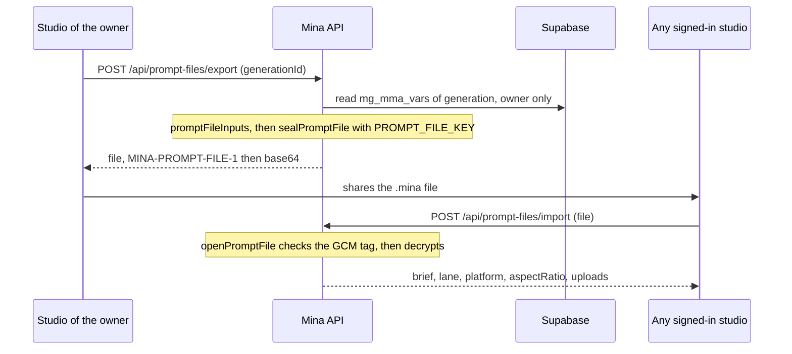

# Prompt files

A `.mina` file holds the studio inputs a generation was made from, encrypted. Its owner exports it, and anyone signed in can drop it on their studio to get those inputs back.



Code: [`promptFile.service.ts`](../../src/services/promptFile.service.ts), [`lib/promptFile.ts`](../../src/lib/promptFile.ts), [`promptFile.types.ts`](../../src/types/promptFile.types.ts), constants `PROMPT_FILE_PREFIX` and `PROMPT_FILE_CIPHER` in [`lib/constants.ts`](../../src/lib/constants.ts).

## What a file holds

`PromptFileInputs`, the studio as it stood when the generation was made:

```json
{
  "brief": "put my serum on the marble table\nwarm morning light",
  "lane": "niche",
  "platform": "tiktok",
  "aspectRatio": "9:16",
  "uploads": [
    { "kind": "scene", "url": "<R2>/mina-assets/owner_<hash>/<uuid>.jpg", "origin": "upload" }
  ]
}
```

`promptFileInputs(vars)` builds it from the generation's `mg_mma_vars`, never from what the browser sends, so a file only ever holds what a generation was really made from:

| Field | From |
|---|---|
| `brief`, `lane`, `platform`, `aspectRatio` | `inputs.brief`, `inputs.still_lane`, `inputs.platform`, `inputs.aspect_ratio` |
| `uploads` | `meta.create_asset_plan.items`, the step 1 items |

For each upload, `slot_hint` is mapped back to its pill (`featured_asset` becomes `product`), and the resized URL is turned back into the plain R2 URL with `plainImage`. Brand memory pictures (`origin: "memory"`) are left out: they are not uploads. Older rows may lack fields, so the defaults are an empty brief, `niche`, `tiktok` and `9:16`.

The upload URLs are the original R2 files, not copies.

## Export

`POST /api/prompt-files/export` with `{ generationId }`. `exportPromptFile(userId, generationId)` reads the row by `mg_id = generation:<generationId>` and `mg_pass_id`, so only the owner can export it. It answers `{ file }`, the text of the `.mina` file.

## Import

`POST /api/prompt-files/import` with `{ file }`. Any signed-in user can import. `importPromptFile(file)` returns the `PromptFileInputs` above, and the studio fills itself in from them.

## The format and the encryption

```text
MINA-PROMPT-FILE-1:<base64 of  iv (12 bytes) | auth tag (16 bytes) | ciphertext>
```

- `PROMPT_FILE_PREFIX` is `MINA-PROMPT-FILE-1:`. The number is the format version, so a new one can be read beside the old.
- The cipher is `aes-256-gcm` (`PROMPT_FILE_CIPHER`), with the 32-byte key from `PROMPT_FILE_KEY` (64 hex characters in `.env`).
- `sealPromptFile(inputs, key)` uses a new random 12-byte IV for every file and encrypts the inputs as JSON.
- `openPromptFile(file, key)` throws `Not a Mina prompt file` without the prefix. GCM checks the tag before it gives anything back, so a file edited by hand, or sealed with another key, fails to open instead of opening wrong.

Because the key lives only on the server, a file opens only on a backend that has the same `PROMPT_FILE_KEY`. Changing the key makes every existing file unreadable.
