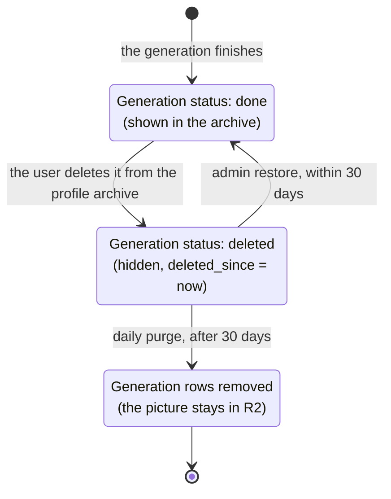

# Soft delete

A generation the user deletes is only hidden at first. An admin can bring it back for 30 days from deletion, then a daily job removes its rows for good. Its picture is never deleted.

The status of a generation row (`mg_status` and `mg_mma_status`, always changed together):

Code: [`generations.service.ts`](../../src/services/generations.service.ts), [`generations.job.ts`](../../src/jobs/generations.job.ts), [`generation.routes.ts`](../../src/routes/generation.routes.ts). Constants `DELETED_STATUS`, `GENERATION_PURGE_DAYS` and `GENERATION_PURGE_HOUR` in [`lib/constants.ts`](../../src/lib/constants.ts).

## Deleting

The backend has no delete endpoint. The frontend (the profile archive) updates the generation row itself, straight in Supabase:

| Column | Value |
|---|---|
| `mg_status` | `deleted` |
| `mg_mma_status` | `deleted` |
| `deleted_since` | the moment of the delete |

The archive stops listing it. Nothing else changes: the step rows, the ledger rows and the picture all stay.

## Restoring

`POST /api/generations/:generationId/restore`, behind `requireUser` and `requireAdmin` (the caller's `mega_customers.mg_role` must be `admin`). `restoreGeneration(generationId)` throws when:

- there is no `generation:<generationId>` row;
- its `mg_status` or `mg_mma_status` is not `deleted`;
- `deleted_since` is missing or older than 30 days.

`deleted_since` is compared as a date, not as text, because Postgres writes a timestamp with `+00:00` where `toISOString()` writes `Z`.

Then it sets both statuses back to `done` and clears `deleted_since`. The answer is `{ restored: generationId }`.

## Purging

Every day at 10:00 Dubai time (`GENERATION_PURGE_HOUR`), `purgeDeletedGenerations()` selects the `generation` rows whose `mg_status` and `mg_mma_status` are both `deleted` and whose `deleted_since` is older than `GENERATION_PURGE_DAYS` (30). For each one it deletes, in this order:

| Order | Rows deleted | Matched by |
|---|---|---|
| 1 | its MMA steps | `mg_record_type: "mma_step"`, `mg_generation_id` |
| 2 | its likes | `mg_record_type: "mma_event"`, `mg_generation_id` |
| 3 | its charge and refund | `mg_record_type: "credit_transaction"`, `mg_ref_id: "mma:<generationId>"` |
| 4 | its image session | `mg_id: "session:<mg_session_id>"` |
| 5 | the generation itself | its `mg_id` |

It returns `{ purged }`, the number of generations removed. See [jobs.md](../jobs.md#deleted-generations-purge) for how the job is scheduled.

## What is never deleted

- **The picture.** The still at `mg_output_url` stays in R2, because it can have been shared. The uploads it was made from stay too.
- The "Mina Studio session" row, which is shared by every Create of a browser tab.
- Brand memories saved from its uploads: they hold their own copies of the pictures.

Two side effects to keep in mind:

- Once purged, the charge and refund transactions are gone from the ledger, while `mega_customers.mg_credits` keeps the balance they produced.
- Deleted generations still count in last month's volume for `mg_cost_data` (`refreshGenerationsPerMonth` counts `deleted` along with `done`).
