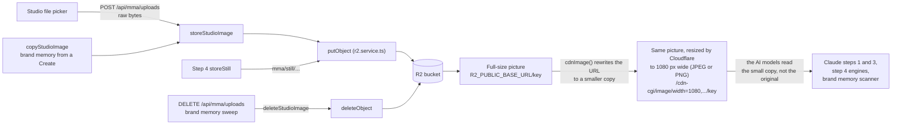

# Uploads and R2

Every picture lives in one Cloudflare R2 bucket, served publicly from `R2_PUBLIC_BASE_URL`. Only the backend writes to it; the browser never holds R2 credentials.



The middle of the diagram is the resizing step: R2 keeps only the full-size picture, and no smaller file is ever saved. When the pipeline needs a picture, `cdnImage()` changes its URL so that Cloudflare sends a 1080-px-wide copy, made on the fly. The AI models get a lighter picture that's quicker to download and read, and the original stays untouched. Details in [Cloudflare resizing](#cloudflare-resizing).

Code: [`r2.service.ts`](../../src/services/r2.service.ts), [`mmaUploads.service.ts`](../../src/services/mma/mmaUploads.service.ts), [`cdnImage` and `plainImage`](../../src/lib/mmaStep1/mmaCreateAssetsLib.ts), [`storeStill`](../../src/services/mma/mmaStep4/mmaStillGenerate.service.ts).

## The R2 client

[`r2.service.ts`](../../src/services/r2.service.ts) talks to R2's S3 API with plain `fetch` and a hand-built AWS SigV4 signature (region `auto`, service `s3`), so there is no AWS SDK. It does two things:

| Function | Does |
|---|---|
| `putObject(key, body, contentType)` | `PUT https://<R2_ACCOUNT_ID>.r2.cloudflarestorage.com/<R2_BUCKET>/<key>` and returns `R2_PUBLIC_BASE_URL/<key>`. |
| `deleteObject(key)` | `DELETE` on the same address. |

Reading a picture is never signed: everything is fetched from its public URL.

## Where files go

| What | Key | Written by |
|---|---|---|
| Studio and profile uploads | `mina-assets/owner_<md5("pass:user:<userId>")>/<uuid>.<jpg, png or webp>` | `storeStudioImage` |
| Brand memory copies of a Create's upload | same folder, new uuid | `copyStudioImage` |
| Generated stills | `mma/still/<ms>_<12 hex>.<ext>` | `storeStill` in step 4 |

The folders are `R2_UPLOADS_PREFIX` and `R2_STILLS_PREFIX` in [`lib/constants.ts`](../../src/lib/constants.ts). The owner folder is named by an MD5 of the pass id, so a user's id never appears in a public URL.

## Uploading

`POST /api/mma/uploads` takes the raw bytes of one picture, not JSON:

- `Content-Type` must be `image/jpeg`, `image/png` or `image/webp` (`UPLOAD_EXTENSIONS`). The studio converts HEIC, AVIF and GIF before sending.
- The size limit is `UPLOAD_MAX_SIZE` (`48mb`), the same as the studio's file picker.
- `storeStudioImage(userId, body, contentType)` picks the extension from the content type and stores the file under a new uuid.
- The answer is `{ url }`, the public URL. The studio keeps it and sends it later in a Create or a brand memory.

## Only our own URLs

Every URL a request carries (`uploads[].url`, `brandMemories[].images`, the brand memory `urls`, the delete `url`) must start with `R2_PUBLIC_BASE_URL/`. The zod schemas in the controllers check this, so the API never fetches a URL of the browser's choosing.

## Deleting

`deleteStudioImage(userId, url)` deletes only a file in the caller's own folder. The key must match exactly `<caller's owner folder>/<36 character uuid>.<jpg|png|webp>`, else it throws `Not one of your uploads`.

Callers: `DELETE /api/mma/uploads` from the studio and the profile, and the daily brand memory sweep. Generated stills in `mma/still/` never match that pattern, so they cannot be deleted through it.

## Copying

`copyStudioImage(userId, url)` downloads a picture from its public URL and stores it again with `storeStudioImage`, under a new uuid. A brand memory saved from a Create uses it, so deleting the memory later never removes the picture the generation was made from.

## Cloudflare resizing

AI models never see the full-size upload. A phone photo can be several thousand pixels wide and a few MB. The models don't need that much detail, and a smaller picture downloads and reads faster. Instead of saving a second, smaller file, Mina asks Cloudflare for a resized copy through the URL. [`cdnImage(publicBaseUrl, url, kind)`](../../src/lib/mmaStep1/mmaCreateAssetsLib.ts) rewrites an R2 URL into Cloudflare's image resizing URL:

```text
<R2_PUBLIC_BASE_URL>/cdn-cgi/image/width=1080,fit=scale-down,quality=85,format=jpeg/<key>   (scene)
<R2_PUBLIC_BASE_URL>/cdn-cgi/image/width=1080,fit=scale-down,quality=90,format=png/<key>    (logo, product)
```

- The width is `MMA_IMAGE_WIDTH` (1080). `fit=scale-down` never enlarges a small picture.
- Scenes go as JPEG. Logos and products go as PNG, so a cutout keeps its transparency.
- Brand memory pictures are always resized as `product`.
- This relies on Cloudflare serving `/cdn-cgi/image/` on the bucket's public domain.

Who reads the resized version:

| Reader | How |
|---|---|
| MMA step 1 | Every inventory picture goes to Claude as its resized URL, and Claude fetches it. |
| MMA step 3 | Reuses step 1's URLs for the pictures it keeps. |
| MMA step 4 | Downloads the same URLs as bytes and sends them to Gemini or OpenAI. |
| Brand memory scanner | Sends the cover's resized URL to gpt-4o-mini. |

`plainImage(url)` removes the `/cdn-cgi/image/<options>` part and gives back the plain R2 URL. It is used when a picture leaves the pipeline: saving a Create's upload as a brand memory or rebuilding the uploads of a `.mina` prompt file.

## Generated stills

Step 4 gets the picture's bytes from the engine, never a link. `storeStill()` names the file first, because the metadata carries the picture's own URL. It writes the SEO and Mina's credit into the file as XMP (an `iTXt` chunk in a PNG, an APP1 segment in a JPEG, no pixel re-encoded), then calls `putObject`. If the XMP cannot be written, the file is stored without it and `mg_meta.provenance.embedded` is false.

Stills are never deleted, not even when their generation is purged because a picture may have been shared. See [soft-delete.md](soft-delete.md).
