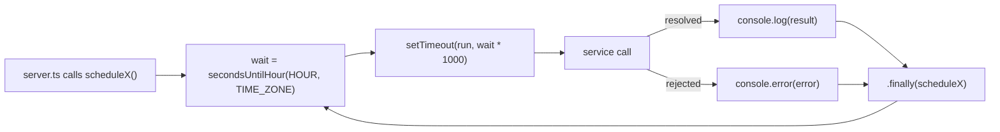

# Jobs

Work the clock triggers rather than a request. Every job lives in [`src/jobs/`](../src/jobs), is started by [`server.ts`](../src/server.ts) and calls a service directly.

## Summary

All hours are Dubai time: [`TIME_ZONE`](../src/lib/constants.ts) is `Asia/Dubai`, which stays at UTC+4 all year, so there is no daylight saving step to plan around.

| Job file | Scheduler | When | Service it calls | Does |
|---|---|---|---|---|
| [`credits.job.ts`](../src/jobs/credits.job.ts) | `scheduleCreditExpiry` | Daily at 08:00 (`CREDIT_EXPIRY_HOUR`) | `sweepExpiredCredits` in [`credits.service.ts`](../src/services/credits.service.ts) | Zeroes expired balances. |
| [`autoRefill.job.ts`](../src/jobs/autoRefill.job.ts) | `scheduleAutoRefill` | Every 10 minutes (`AUTO_REFILL_INTERVAL_MS`), first run 10 minutes after boot | `runAutoRefillCycle` in [`autoRefill.service.ts`](../src/services/autoRefill.service.ts) | Charges saved cards of customers below their threshold. |
| [`costRates.job.ts`](../src/jobs/costRates.job.ts) | `scheduleExchangeRate` | At boot, then daily at 20:00 (`EXCHANGE_RATE_HOUR`) | `refreshUsdPerGbp` in [`mmaCostRates.service.ts`](../src/services/mma/mmaCostRates.service.ts) | Reads the GBP to USD rate into memory. |
| [`costRates.job.ts`](../src/jobs/costRates.job.ts) | `scheduleGenerationsCount` | At boot, then on the 1st of each month at 08:00 (`GENERATIONS_COUNT_HOUR`) | `refreshGenerationsPerMonth` in [`mmaCostRates.service.ts`](../src/services/mma/mmaCostRates.service.ts) | Counts last month's finished generations into memory. |
| [`brandMemory.job.ts`](../src/jobs/brandMemory.job.ts) | `scheduleBrandMemoryExpiry` | Daily at 09:00 (`BRAND_MEMORY_EXPIRY_HOUR`) | `sweepExpiredBrandMemories`, then `resetIdleUseCounts`, in [`brandMemory.service.ts`](../src/services/brandMemory.service.ts) | Deletes memories unused for 90 days, resets `use_count` after 7 idle days. |
| [`generations.job.ts`](../src/jobs/generations.job.ts) | `schedulePurgeDeletedGenerations` | Daily at 10:00 (`GENERATION_PURGE_HOUR`) | `purgeDeletedGenerations` in [`generations.service.ts`](../src/services/generations.service.ts) | Removes the rows of generations deleted more than 30 days ago. |

## The shared pattern

Every daily job has the same shape:

1. [`secondsUntilHour(hour, TIME_ZONE)`](../src/lib/clock.ts) reads the wall clock in Dubai and returns the seconds until the next `hour:00`. When it is exactly that second, it returns a whole day, so a job that just ran never schedules itself straight back in.
2. `setTimeout` waits that long, then calls the service.
3. `.then` logs the result. `.catch` logs the error: an unhandled rejection inside a timer would take the whole process down, and a sweep that failed today should still run tomorrow.
4. `.finally` calls the scheduler again, which reads the clock again.

Why a chain of `setTimeout` and not `setInterval`:

- The delay is measured again after every run, so a slow run, a failed one or a timer that fired late lands on the next hour instead of drifting.
- The next run is armed only once the current one has finished, so two runs never overlap. This matters most for auto-refill, where an overlap could charge someone twice.

Things the pattern does not do:

- No catch-up. If the process is down at the hour, that day is skipped and the work happens at the next run.
- No coordination between processes. Every running `server.ts` starts its own timers, so two instances run every job twice.
- The daily jobs do nothing at boot, they only wait. The two cost-rate jobs are the exception: they refresh once at boot, then follow their schedule.

## Credit expiry

`sweepExpiredCredits` selects every `mega_customers` row with `mg_expires_at <= now` and `mg_credits > 0`. For each one it:

1. writes a `credit_transaction` with `mg_reason: "expired"`, `mg_ref_type: "expiration"`, `mg_ref_id: "exp_<passId>_<ISO time>"` and `mg_delta` equal to minus the whole balance;
2. sets `mg_credits: 0`, `mg_credit_lots: []` and `mg_expires_at: null`.

It returns `{ swept, creditsRemoved }`. The balance expires as a whole when `mg_expires_at` (the latest lot's expiry) passes. See [features/credits-and-billing.md](features/credits-and-billing.md).

## Auto-refill

Runs on a flat interval rather than an hour, with the same self-rescheduling `setTimeout`. `runAutoRefillCycle` pages through `mega_customers` whose `mg_mma_preferences` contains `{ autoRefill: { enabled: true } }`, `AUTO_REFILL_PAGE_SIZE` (200) rows at a time, ordered by `mg_pass_id`. One customer's error is logged and counted, and never stops the others. It returns `{ scanned, charged, failed, reset }`. The per-customer rules are in [features/credits-and-billing.md](features/credits-and-billing.md#auto-refill).

## Exchange rate

`refreshUsdPerGbp` fetches `EXCHANGE_RATES_URL` (`https://open.er-api.com/v6/latest/GBP`) and keeps `rates.USD` in memory, where `costRates()` reads it when a generation's `mg_cost_data` is priced. A failed read keeps the last rate, which starts at `MMA_COSTS.defaultUsdPerGbp` (1.27).

## Generations count and cost rates

`refreshGenerationsPerMonth` counts `generation` rows created last calendar month (UTC) whose `mg_status` is `done`, `succeeded` (older rows) or `deleted`. The count is kept in memory and divides the fixed monthly cost (`MMA_COSTS.fixedMonthlyTotalUsd`) in each `mg_cost_data`. An error or a zero count falls back to `MMA_COSTS.defaultGenerationsPerMonth` (1000).

This one runs monthly, so it uses [`msUntilNextMonthStart`](../src/lib/clock.ts) instead of `secondsUntilHour`. A month can be longer than the longest delay one `setTimeout` can hold (about 24.8 days), so `runIn()` in the job file chains timers until the target is reached.

## Brand memory sweep

Runs two services in a row. The expired ones go first, so no row about to be deleted is written to.

1. `sweepExpiredBrandMemories` finds `product` rows whose `mg_mma_vars.last_used_at` is older than `BRAND_MEMORY_EXPIRY_DAYS` (90). It deletes each row, then each of its pictures from R2 through `deleteStudioImage`. A picture that fails to delete is logged and left behind; the row is already gone. Returns `{ deleted }`.
2. `resetIdleUseCounts` finds `product` rows whose `last_used_at` is older than `BRAND_MEMORY_USE_COUNT_RESET_DAYS` (7) and whose `use_count` is not 0, and sets `use_count` back to 0. Returns `{ reset }`.

A memory with no `last_used_at` is left alone by both. Memories created by this backend always have one: `brandMemoryVars` sets it to the creation time. See [features/brand-memory.md](features/brand-memory.md).

## Deleted generations purge

`purgeDeletedGenerations` finds `generation` rows whose `mg_status` and `mg_mma_status` are both `deleted` and whose `deleted_since` is older than `GENERATION_PURGE_DAYS` (30), then deletes their rows one generation at a time. It never deletes a picture. Returns `{ purged }`. What exactly goes is listed in [features/soft-delete.md](features/soft-delete.md).
