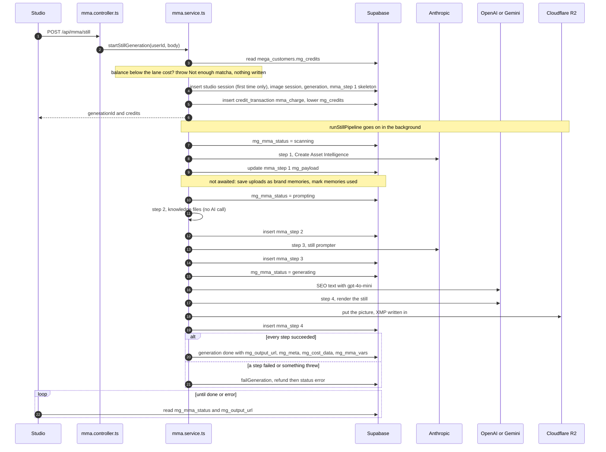
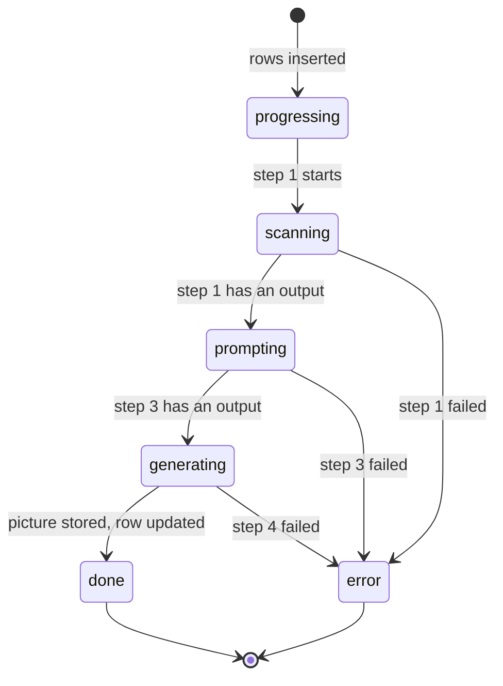

# MMA pipeline

How a Create turns a brief and some pictures into a still image. This is the core of the product, so read it before touching anything under `services/mma/`.



## Where the code is

| Part | Service | Pure helpers |
|---|---|---|
| Request | [`mma.controller.ts`](../src/controllers/mma/mma.controller.ts) (`postStillGeneration`) | |
| Orchestration | [`mma.service.ts`](../src/services/mma/mma.service.ts) (`startStillGeneration`, `runStillPipeline`, `failGeneration`) | |
| Step 1 | [`mmaStep1/mmaCreateAssets.service.ts`](../src/services/mma/mmaStep1/mmaCreateAssets.service.ts) | [`mmaStep1/mmaCreateAssetsLib.ts`](../src/lib/mmaStep1/mmaCreateAssetsLib.ts) |
| Step 2 | [`mmaStep2/mmaKnowledgeFiles.service.ts`](../src/services/mma/mmaStep2/mmaKnowledgeFiles.service.ts) | [`mmaStep2/mmaKnowledgeFilesLib.ts`](../src/lib/mmaStep2/mmaKnowledgeFilesLib.ts) |
| Step 3 | [`mmaStep3/mmaStillPrompter.service.ts`](../src/services/mma/mmaStep3/mmaStillPrompter.service.ts) | [`mmaStep3/mmaStillPrompterLib.ts`](../src/lib/mmaStep3/mmaStillPrompterLib.ts) |
| SEO | [`mmaSeo.service.ts`](../src/services/mma/mmaSeo.service.ts) | [`mmaSeo/mmaSeoLib.ts`](../src/lib/mmaSeo/mmaSeoLib.ts) |
| Step 4 | [`mmaStep4/mmaStillGenerate.service.ts`](../src/services/mma/mmaStep4/mmaStillGenerate.service.ts) | [`mmaStep4/mmaStillGenerateLib.ts`](../src/lib/mmaStep4/mmaStillGenerateLib.ts) |
| Cost | [`mmaCostRates.service.ts`](../src/services/mma/mmaCostRates.service.ts) | [`mmaCost/mmaCostLib.ts`](../src/lib/mmaCost/mmaCostLib.ts) |
| Final vars | | [`mmaVars/mmaVarsLib.ts`](../src/lib/mmaVars/mmaVarsLib.ts) |
| Types | [`types/mma/mma.types.ts`](../src/types/mma/mma.types.ts) | |
| Settings | [`lib/constants.ts`](../src/lib/constants.ts) | |

## Starting a Create

`startStillGeneration` does everything the studio waits for, then hands over to `runStillPipeline` without awaiting it.

1. Reads `mega_customers.mg_credits`. When the balance is below `STILL_GENERATION_COSTS[lane]` it throws `Not enough matcha` before writing anything.
2. Looks for an existing `session:<studioSessionId>` row of this user.
3. Inserts these rows in one call, each with `defaultToNull: false` so unset columns keep the table's default:

| Row | `mg_id` | Written |
|---|---|---|
| Mina Studio session | `session:<studioSessionId>` | Only the first time this browser tab's session is seen. `mg_meta`: `{ ip, requestId, userAgent }`. |
| Image session | `session:<new uuid>` | Every Create. `mg_meta`: `{ flow: "still_create", source: "mma" }`. |
| Generation | `generation:<generationId>` | Every Create. `mg_status` and `mg_mma_status` are `progressing`. `mg_session_id` points to the image session. |
| Step 1 skeleton | `mma_step:<generationId>:1` | Every Create. `mg_step_type: "create_asset_intelligence"`, `mg_payload: {}`. Step 1 fills it in. |

4. Charges the matchas with `recordTransaction`: a `credit_transaction` row with `mg_delta: -cost`, `mg_reason: "mma_still_<lane>"`, `mg_ref_type: "mma_charge"`, `mg_ref_id: "mma:<generationId>"`, `mg_source: "mma"`. Then lowers `mega_customers.mg_credits`. The credit lots are not touched.
5. Answers `{ generationId, credits }` and starts `runStillPipeline` in the background. Anything that pipeline throws is logged and ends in `failGeneration` with the code `mma_pipeline_failed`.

## Status the studio polls

`mg_mma_status` on the generation row tells the studio which step is running, so it can choose what Mina types meanwhile. The studio reads it straight from Supabase until it is `done` or `error`.



| `mg_mma_status` | Set by | When |
|---|---|---|
| `progressing` | `startStillGeneration` | The generation row is inserted. |
| `scanning` | `markStatus` | Just before step 1. |
| `prompting` | `markStatus` | Step 1 succeeded, just before step 2. |
| `generating` | `markStatus` | Step 3 succeeded, just before the SEO text and step 4. |
| `done` | the last `updateGeneration` | Step 4 stored the picture. `mg_status` becomes `done` too. |
| `error` | `failGeneration` | Any step failed, or anything threw. `mg_status` becomes `error` too. |

`markStatus` only logs a failed update: the picture matters more than the status line. `mg_status` stays `progressing` until the end.

## How steps save their results

Every step returns its own `mg_payload` and never throws on a provider error: it writes the message to the payload's `error`, leaves `output` null and returns. `runStillPipeline` then stops and calls `failGeneration` with that step's code. Each payload carries a `timing` of `{ started_at, ended_at, duration_ms }` ([`stepTiming`](../src/lib/date.ts)).

| Step | `mg_id` | `mg_step_type` | Failure code |
|---|---|---|---|
| 1 | `mma_step:<generationId>:1` | `create_asset_intelligence` | `create_asset_intelligence_failed` |
| 2 | `mma_step:<generationId>:2` | `knowledge_files` | none, it cannot fail on its own |
| 3 | `mma_step:<generationId>:3` | `gpt_still_one_shot` | `gpt_still_one_shot_failed` |
| 4 | `mma_step:<generationId>:4` | `nanobanana_generate` or `gpt_image_2_generate` | `nanobanana_generate_failed` or `gpt_image_2_generate_failed` |

Step 1's row already exists, so its payload is written with an update. Steps 2, 3 and 4 are inserted when they end, dated by their `timing.ended_at`. Every step row also has `mg_parent_id: "generation:<generationId>"` and `mg_step_no`.

In the JSON examples below, values are made up and long arrays and strings are trimmed. `<R2>` stands for `R2_PUBLIC_BASE_URL`.

## Step 1: Create Asset Intelligence

Claude, acting as the "Create Asset Director", reads the brief and every picture and decides what each picture is for. Function: `runCreateAssetIntelligence(brief, uploads, brandMemories)`.

**Input.** The inventory: the uploads first, numbered from 1 in the order they were added, then every picture of every ticked brand memory, numbered on from there. Each picture URL becomes its Cloudflare-resized version with [`cdnImage`](../src/lib/mmaStep1/mmaCreateAssetsLib.ts). The first user block is `briefMessage()` (the brief and the inventory as JSON). Then each picture follows its caption from `imageNote()`. Claude fetches the pictures from their URLs itself. Claude is asked even with no picture, since the brief alone gives the production profile step 2 needs.

**Model and settings.** [`CREATE_ASSET_DIRECTOR`](../src/lib/constants.ts):

| Setting | Value |
|---|---|
| model | `claude-sonnet-5` |
| max_tokens | 3000 |
| effort | `low` |
| thinking | `adaptive` |
| system | `CREATE_ASSET_DIRECTOR_PROMPT`, cached (`cache_control: ephemeral`) |
| tools | `CREATE_ASSET_PLAN_TOOL` (`create_asset_plan`, `strict: true`), `tool_choice: auto` |

**Output.** The tool input is the raw plan (`CreateAssetPlan`). `planOutput()` merges it with the inventory into a `CreateAssetOutput` (schema `mina.create.asset-plan.v3`). It also works out `person_recast`, `color_intent`, `used_memory_ids` and `unused_memory_ids`. A plan missing a picture throws. An answer without the tool call is an error.

**Saved.** The whole `CreateAssetPayload` goes to the `mg_payload` of `mma_step:<generationId>:1`: `raw` (the tool input as a string), `error`, `input`, `usage`, `output`, `timing`, `request` (what was sent, plus the cache and routing details from `askClaude`) and `provider`.

```json
{
  "error": null,
  "input": {
    "user_brief": "put my serum on the marble table\nwarm morning light",
    "inventory": [
      {
        "url": "<R2>/cdn-cgi/image/width=1080,fit=scale-down,quality=85,format=jpeg/mina-assets/owner_<hash>/<uuid>.jpg",
        "name": "Scene / base upload",
        "index": 1,
        "origin": "upload",
        "memory_id": null,
        "pill_hint": "scene",
        "selection_source": null
      },
      {
        "url": "<R2>/cdn-cgi/image/width=1080,fit=scale-down,quality=90,format=png/mina-assets/owner_<hash>/<uuid>.png",
        "name": "Aurora Serum",
        "index": 2,
        "origin": "memory",
        "memory_id": "9f1c2e7a-0d3b-4a51-b8a4-2c6e1f0d7b55",
        "pill_hint": "featured_asset",
        "selection_source": "pill"
      }
    ]
  },
  "output": {
    "schema": "mina.create.asset-plan.v3",
    "source": "vision_intent_classifier",
    "model": "claude-sonnet-5",
    "strategy": "scene_edit",
    "summary": "Insert the Aurora Serum bottle into the customer's marble table scene.",
    "preserve_scene": true,
    "target_output_medium": "photographic",
    "person_recast": { "active": false, "reason": "no_person_reference" },
    "color_intent": { "global_scene_grade": true, "explicit_asset_color": false },
    "items": [
      {
        "index": 1,
        "asset_id": "create_asset_1",
        "origin": "upload",
        "slot_hint": "scene",
        "semantic_type": "scene",
        "job": "base_scene",
        "use_in_generation": true,
        "background_policy": "use_as_scene",
        "color_policy": "preserve_identity_color"
      },
      {
        "index": 2,
        "asset_id": "create_asset_2",
        "origin": "memory",
        "memory_id": "9f1c2e7a-0d3b-4a51-b8a4-2c6e1f0d7b55",
        "slot_hint": "featured_asset",
        "semantic_type": "product",
        "job": "identity_reference",
        "use_in_generation": true,
        "background_policy": "extract_subject",
        "color_policy": "adapt_to_scene_grade"
      }
    ],
    "production_profile": {
      "visual_register": "editorial",
      "format": "image_edit",
      "capture_device": "professional_camera",
      "subjects": ["product", "scene_or_location"],
      "physical_realism": "required",
      "human_safety_scope": ["none"],
      "confidence": 0.86
    },
    "used_memory_ids": ["9f1c2e7a-0d3b-4a51-b8a4-2c6e1f0d7b55"],
    "unused_memory_ids": [],
    "uncertain_memory_ids": []
  },
  "usage": {
    "model": "claude-sonnet-5",
    "stop_reason": "tool_use",
    "input_tokens": 900,
    "output_tokens": 1400,
    "cache_read_input_tokens": 0,
    "cache_creation_input_tokens": 4200
  },
  "timing": { "started_at": "2026-11-06T09:00:01.120Z", "ended_at": "2026-11-06T09:00:15.330Z", "duration_ms": 14210 }
}
```

### Brand memory pictures in the inventory

Each picture of a ticked brand memory becomes its own inventory item, read as if it came under the product pill:

- `origin: "memory"` and `selection_source: "pill"`;
- `memory_id`: the memory's `mg_id` without the `product:` prefix (`BRAND_MEMORY_ID_PREFIX`);
- `name`: the memory's name, and its caption ends with "This came from the customer's saved Memory library.";
- the URL is resized as a product (PNG, so a cutout keeps its transparency).

After the plan comes back, `planOutput` sorts the memories:

- `used_memory_ids`: memories with at least one picture Claude marked `use_in_generation: true`. One used picture is enough for a memory with several.
- `unused_memory_ids`: the rest of the memories that were sent.
- `uncertain_memory_ids`: always empty for now.

These end up in `mg_mma_vars.meta.product_memory_resolution`, where the studio reads `unused_ids` to tell the user which memories were not used.

### Background work after step 1

Once step 1 has an output, `runStillPipeline` fires two calls it never awaits. Their errors are only logged with `logMmaError`, and they never fail the generation.

1. **Save uploads as brand memories.** Items pass [`canBeBrandMemory(item, usingCategories)`](../src/lib/brandMemory/brandMemoryLib.ts), where `usingCategories` are the categories of the memories this Create sent. An item qualifies when:
   - its `origin` is `upload` (not a scene library pick, not a memory) and `use_in_generation` is true;
   - its `semantic_type` is one of `BRAND_MEMORY_SEMANTIC_TYPES`: `logo`, `other_design`, `person`, `product`;
   - it is not a `person` while a `model` memory is in use;
   - it is not a `logo` or `other_design` while a `logo` or `illustration` memory is in use.

   The qualifying URLs, turned back into plain R2 URLs with `plainImage`, go to `saveUsedUploadsAsBrandMemories` in [`brandMemory.service.ts`](../src/services/brandMemory.service.ts). See [features/brand-memory.md](features/brand-memory.md).
2. **Mark memories used.** `markBrandMemoriesUsed(userId, used_memory_ids)` adds 1 to each memory's `use_count` and sets its `last_used_at` to now.

## Step 2: Knowledge files

Picks the guides step 3 will give Claude. There is no AI call: it checks structured facts against a catalog. Function: `runKnowledgeFiles(lane, assetPlan)`.

**Input.** `knowledgeFacts()` builds the facts from step 1's plan (`production_profile`, `preserve_scene`, `target_output_medium`) plus the lane's engine from `STILL_ENGINES`: `nano_banana` for niche, `gpt_image` for creative and creative_plus. Fixed facts for a still: `media: "image"`, `phase: "image_prompt"`, `audio_mode: "muted"`, `camera_plan: false`.

**Catalog and guides.** The guides are the Markdown files in [`src/server/mma/knowledge`](../src/server/mma/knowledge), listed in [`knowledge-router-catalog.json`](../src/server/mma/knowledge/knowledge-router-catalog.json). The service reads the catalog and every guide once, when the module loads. Line endings are turned into `\n` first, so the sizes and SHA-256 hashes in the receipts are stable. Tokens are estimated as characters divided by 4.

**Routing.** `knowledgeRoute()` checks every guide in catalog order. The first check that fails gives its `reason_code`:

1. media gate (`media_gate_failed`),
2. phase gate (`phase_gate_failed`),
3. every condition in `match.all` (`required_fact_mismatch`),
4. at least one branch of `match.any_of`, when it has any (`no_positive_target_match`).

A guide that passes all four is `included`. A fact the catalog tests but the still does not carry reads as `unknown`. `human_safety_scope` drops `none` and `unknown` before matching, so they never unlock a guide.

Only six guides can ever apply to a still:

| Key | File | Included when |
|---|---|---|
| `nano_banana` | `nano-banana-pro-how-to-use.md` | engine is `nano_banana` (niche) |
| `gpt_image` | `gpt-image-2-how-to-use.md` | engine is `gpt_image` (creative, creative_plus) |
| `image_realism` | `image-realism-and-posing.md` | photographic, physical realism required, and a person, body part, product, place or material in the subjects |
| `editorial_still_life` | `editorial-still-life.md` | editorial register, a product or material, and format `product_image` |
| `iphone_aesthetic` | `iphone-aesthetic.md` | capture device `phone`, or register `phone_native` |
| `safe_wording` | `provider-safe-wording.md` | `human_safety_scope` has `person`, `skin` or `wardrobe` |

The other guides in the folder are for video and audio, and fail the media gate.

**Saved.** Inserted as `mma_step:<generationId>:2`. Its `error` is always null.

```json
{
  "error": null,
  "input": {
    "lane": "niche",
    "mode": "create",
    "facts": {
      "media": "image",
      "phase": "image_prompt",
      "engine": "nano_banana",
      "audio_mode": "muted",
      "camera_plan": false,
      "target_format": "image_edit",
      "source_faithful": true,
      "target_subjects": ["product", "scene_or_location"],
      "human_safety_scope": ["none"],
      "target_audio_nature": "unknown",
      "target_output_medium": "photographic",
      "target_capture_device": "professional_camera",
      "target_visual_register": "editorial",
      "requires_physical_realism": true
    }
  },
  "output": {
    "method": "facts_catalog_v1",
    "selected": [
      { "key": "image_realism", "chars": 6185, "tokens": 1547 },
      { "key": "nano_banana", "chars": 24070, "tokens": 6018 }
    ],
    "route": {
      "schema": "mina.knowledge.route-receipt.v1",
      "selected_keys": ["image_realism", "nano_banana"],
      "selected_token_count": 7565,
      "candidates": [
        { "key": "safe_wording", "status": "excluded", "reason_code": "no_positive_target_match" },
        { "key": "seedance_common", "status": "excluded", "reason_code": "media_gate_failed" },
        { "key": "image_realism", "status": "included", "reason_code": "included" },
        { "key": "editorial_still_life", "status": "excluded", "reason_code": "no_positive_target_match" },
        { "key": "gpt_image", "status": "excluded", "reason_code": "required_fact_mismatch" }
      ]
    }
  },
  "timing": { "started_at": "2026-11-06T09:00:15.400Z", "ended_at": "2026-11-06T09:00:15.402Z", "duration_ms": 2 }
}
```

Each candidate also carries its full `evidence` (every check, matched or not), its `content_hash` and its token count, so you can see why a guide was or was not picked.

## Step 3: Still prompter

Claude writes the one clean prompt the image engine will render. Function: `runStillPrompter(brief, assetPlan, docs)`.

**Input.** Only the pictures step 1 kept (`use_in_generation` true and `job` not `ignore`):

- The first user block is `prompterInput()` as JSON: the brief, step 1's strategy, `preserve_scene` and summary, the scene edit and person recast contracts when they apply, `image_order_for_ai` (one entry per kept picture), `featured_assets` (the kept pictures that are not the base scene), fixed `notes`, and the keys and titles of the picked guides.
- Then each kept picture follows its caption (`imageCaption()`): a role written from its job, semantic type, background policy and colour policy, plus step 1's reason.
- The system prompt is `prompterSystem(docs)`: `STILL_PROMPTER_PROMPT`, then the full text of every guide step 2 picked, then a "knowledge receipt" block. It is cached.

`isSceneEdit()` is true only when the strategy is `scene_edit`, `preserve_scene` is true and a kept picture really is the base scene.

**Model and settings.** [`STILL_PROMPTER`](../src/lib/constants.ts):

| Setting | Value |
|---|---|
| model | `claude-opus-5-5` |
| max_tokens | 8000 |
| effort | `high` |
| thinking | not set |
| tools | none: Claude answers with a JSON object as text |

**Output.** Claude returns `{ clean_prompt, negative_prompt, knowledge_receipt }`. The text between the first `{` and the last `}` is parsed. `prompterOutput()` then:

- turns `negative_prompt` into one `Avoid: a, b, c.` line after the prompt (`prompter_clean_prompt`);
- on a scene edit, puts the `SCENE_EDIT_LOCK` line in front of it (`clean_prompt`, the one step 4 renders);
- checks the receipt for each guide (`verifyReceipt`): a guide counts as `applied` only when Claude says so and both quotes are found word for word, in the guide and in the prompt, each 16 to 320 characters long with at least 3 words.

**Saved.** Inserted as `mma_step:<generationId>:3`. `labeledImages` (the pictures sent, with their role and note) is kept in the payload: step 4 renders from those same pictures.

```json
{
  "ctx": "Tip 1: You are an expert director writing strong image-generation prompts for AI.\nAvoid NSFW ke.......",
  "error": null,
  "input": {
    "user_brief": "put my serum on the marble table\nwarm morning light",
    "create_strategy": "scene_edit",
    "preserve_scene": true,
    "person_recast": { "active": false, "reason": "no_person_reference" },
    "person_recast_contract": "",
    "image_order_for_ai": [
      { "image": 1, "semantic_type": "scene", "job": "base_scene", "name": "Scene / base upload" },
      { "image": 2, "semantic_type": "product", "job": "identity_reference", "name": "Aurora Serum" }
    ],
    "knowledge_guides": [{ "key": "image_realism" }, { "key": "nano_banana" }]
  },
  "output": {
    "parsed_ok": true,
    "debug": {
      "clean_prompt": "In the scene, replace the glass jar on the marble table with the Aurora Serum bottle, everything else in the frame stays exactly as it is.",
      "negative_prompt": "no deformed hands, no extra fingers, no floating text"
    },
    "prompter_clean_prompt": "In the scene, replace the glass jar on the marble table with the Aurora Serum bottle, everything else in the frame stays exactly as it is.\n\nAvoid: deformed hands, extra fingers, floating text.",
    "clean_prompt": "<SCENE_EDIT_LOCK>\n\nIn the scene, replace the glass jar ... stays exactly as it is.\n\nAvoid: deformed hands, extra fingers, floating text.",
    "knowledge_receipt": [
      { "key": "image_realism", "applied": false, "verification": "reported_not_applied", "reported_applied": false },
      { "key": "nano_banana", "applied": true, "verification": "exact_guide_and_prompt_evidence", "reported_applied": true }
    ]
  },
  "labeledImages": [
    { "url": "<R2>/cdn-cgi/image/width=1080,.../owner_<hash>/<uuid>.jpg", "role": "BASE SCENE (the customer's own image) ...", "note": "<step 1 reason>" },
    { "url": "<R2>/cdn-cgi/image/width=1080,.../owner_<hash>/<uuid>.png", "role": "PRODUCT IDENTITY ... Identity: Aurora Serum", "note": "<step 1 reason>" }
  ],
  "usage": {
    "model": "claude-opus-5-5",
    "stop_reason": "end_turn",
    "input_tokens": 3000,
    "output_tokens": 2500,
    "cache_read_input_tokens": 9000,
    "cache_creation_input_tokens": 0
  }
}
```

## SEO text

Between step 3 and step 4, `writeSeo()` writes the picture's search text. It has no step row of its own.

- **Input:** Claude's own prompt (`output.debug.clean_prompt`), without the lock line or the `Avoid:` list, plus the ratio and platform.
- **Model:** `gpt-4o-mini` (`SEO_WRITER`) through `openAiJson()`, with `SEO_WRITER_PROMPT`. It returns `{ sentence, keywords }`.
- **Output:** [`buildSeo()`](../src/lib/mmaSeo/mmaSeoLib.ts) builds an `MmaSeo`: alt text, description, up to 28 keywords, a `trace` and a schema.org `ImageObject`, all crediting Mina. It never fails: without gpt-4o-mini's sentence it falls back to a cleaned version of the prompt (`decidedBy: "prompt"`), then to a fixed line (`decidedBy: "template"`).
- **Saved:** written into the picture as XMP in step 4, and into `mg_meta.seo` on the generation at the end. Its tokens go to `spend.seo`.

## Step 4: Image generation

Renders the still and stores it in R2. `runNanoBanana()` on the niche lane, `runGptImage()` on creative and creative_plus.

**Input.** `stillPrompt(clean_prompt)`: step 3's prompt with the sparkle suppression line added at the end. The pictures are step 3's `labeledImages` URLs, downloaded as bytes (`readImage`), because neither engine reads a URL itself.

**Model and settings.** From [`STILL_RENDERERS`](../src/lib/constants.ts):

| Lane | Constant | Model | Settings | Client |
|---|---|---|---|---|
| `niche` | `NANOBANANA` | `gemini-3-pro-image-preview` (NanoBanana Pro) | `imageSize: "4K"`, the request's aspect ratio, `responseModalities: ["IMAGE"]`, no search tools | `geminiImage()` |
| `creative` | `GPT_IMAGE` | `gpt-image-2.5-flare` | `quality: max`, `background: auto`, `moderation: low`, `output_format: png`, size in a 1536 x 1536 pixel budget (9:16 gives `1152x2048`) | `openAiImage()` |
| `creative_plus` | `GPT_IMAGE_PLUS` | `gpt-image-2.5-sunburst` | same as creative, pixel budget 3840 x 2160 (9:16 gives `2160x3840`) | `openAiImage()` |

`gptImageSize()` makes the short side as large as the budget allows, rounds both sides to multiples of 16 and keeps the ratio. GPT Image is called on `/v1/images/edits` with the pictures as multipart files, or on `/v1/images/generations` when there is no picture.

**Output.** `storeStill()` names the file `mma/still/<ms>_<12 hex>.<ext>` (`R2_STILLS_PREFIX`), with the extension taken from the content type the engine returned. It writes the SEO into the file as XMP ([`embedXmp`](../src/lib/mmaSeo/mmaSeoLib.ts), no pixel re-encoded), then uploads it with `putObject`. If the XMP cannot be written, the picture is stored anyway and the provenance says `embed_failed`.

**Saved.** Inserted as `mma_step:<generationId>:4`. `output` is the public R2 URL.

```json
{
  "error": null,
  "input": {
    "model": "gpt-image-2.5-flare",
    "provider": "openai",
    "prompt": "<step 3 clean_prompt>\n\nno starburst, no star sparkle, no sparkle, ...",
    "size": "1152x2048",
    "quality": "max",
    "background": "auto",
    "moderation": "low",
    "image_input": ["<R2>/cdn-cgi/image/width=1080,.../<uuid>.jpg", "<R2>/cdn-cgi/image/width=1080,.../<uuid>.png"],
    "aspect_ratio": "9:16",
    "output_format": "png"
  },
  "output": "<R2>/mma/still/1762419630123_a1b2c3d4e5f6.png",
  "provider": {
    "openai": {
      "size": "1152x2048",
      "model": "gpt-image-2.5-flare",
      "quality": "max",
      "usage": { "input_tokens": 1800, "output_tokens": 6200 }
    }
  },
  "timing": { "started_at": "2026-11-06T09:00:48.010Z", "ended_at": "2026-11-06T09:01:31.540Z", "duration_ms": 43530 }
}
```

On the niche lane the payload is a `NanoBananaPayload` instead: `input` has `provider: "gemini"`, `resolution: "4K"`, `image_search: false`, `google_search: false` and `response_modalities: ["IMAGE"]`, and `provider` is `{ "gemini": { "model": "gemini-3-pro-image-preview" } }`.

## Done

When step 4 has an output, one `updateGeneration` writes:

| Column | Value |
|---|---|
| `mg_status`, `mg_mma_status` | `done` |
| `mg_prompt` | step 3's `clean_prompt` |
| `mg_output_url` | the R2 URL of the still |
| `mg_meta` | `{ seo, provenance }` |
| `mg_cost_data` | `costData(lane, spend, true, costRates())` |
| `mg_mma_vars` | `stillMmaVars(...)` |

The picture already exists at this point, so a failure of this update is only logged: no refund, and the generation is not marked as failed. It would stay on `generating`.

## Fail and refund

`failGeneration()` runs when a step returns no output, or when anything throws (`mma_pipeline_failed`):

1. `refundMmaCharge(passId, generationId, cost)` in [`credits.service.ts`](../src/services/credits.service.ts) gives the matchas back, once: a `credit_transaction` with `mg_reason` and `mg_ref_type` `mma_refund`, `mg_ref_id: "mma:<generationId>"`, `mg_source: "mma"`, and a new lot that keeps the customer's current expiry. A second call finds that row and does nothing. The refund goes first because it is what the customer cannot do without.
2. Updates the generation: `mg_status` and `mg_mma_status` `error`, `mg_error: { code, message }`, and `mg_cost_data` priced with `isCharged: false` (nothing sold, so `matchas_charged` is 0 and the margins are null).

## Cost data

Every paid call adds its usage to an `MmaSpend` object as it returns: `claude` (steps 1 and 3), `seo` and `image`. Usage is recorded even when the step fails after the call, so a failed generation is still priced.

[`costData()`](../src/lib/mmaCost/mmaCostLib.ts) turns it into `mg_cost_data`:

- Each provider is priced from the per-million-token prices in [`lib/constants.ts`](../src/lib/constants.ts): `CLAUDE_PRICES`, `OPENAI_CHAT_PRICES`, `GPT_IMAGE_PRICES`, `GEMINI_IMAGE_PRICES`. Sunburst's prices are a copy of flare's until they are known.
- `model_cost_usd` is the image engine. `mma_cost_usd` is Claude plus the SEO writer. `api_cost_usd` is both.
- The sell price is the matchas charged times one matcha's price: the smallest pack's GBP price per matcha, in USD. The `_bulk_` fields use the 5000 pack instead.
- `fixed_overhead_usd` is `MMA_COSTS.fixedMonthlyTotalUsd` divided by the generations per month.
- The `_pct` fields are ratios (0.56 means 56%), and null when there is nothing to divide by.

The two rates come from [`mmaCostRates.service.ts`](../src/services/mma/mmaCostRates.service.ts) through `costRates()`. They live in memory: `usdPerGbp` (refreshed daily) and `generationsPerMonth` (refreshed monthly) by the jobs in [jobs.md](jobs.md), with defaults until the first refresh.

```json
{
  "provider": "nanobanana",
  "providers": [
    { "usd": 0.2466, "label": "NanoBanana Pro (gemini-3-pro-image-preview)", "detail": "4K still", "provider": "nanobanana" },
    { "usd": 0.0263, "label": "Claude (claude-sonnet-5)", "detail": "1 call (real usage)", "provider": "claude" },
    { "usd": 0.0638, "label": "Claude (claude-opus-5-5)", "detail": "1 call (real usage)", "provider": "claude" },
    { "usd": 0.00011, "label": "GPT (gpt-4o-mini)", "detail": "1 call (real usage)", "provider": "openai" }
  ],
  "model_cost_usd": 0.2466,
  "mma_cost_usd": 0.09021,
  "api_cost_usd": 0.33681,
  "matchas_charged": 1,
  "matcha_unit_price_usd": 0.762,
  "sell_price_usd": 0.762,
  "profit_usd": 0.42519,
  "margin_pct": 0.55799,
  "markup_pct": 1.2624,
  "fixed_monthly_total_usd": 2350,
  "est_generations_per_month": 1000,
  "fixed_overhead_usd": 2.35,
  "total_cost_usd": 2.68681,
  "profit_after_fixed_usd": -1.92481,
  "cost_schema_version": "mma-cost-v3-2026-07-24"
}
```

## Final mg_mma_vars

[`stillMmaVars()`](../src/lib/mmaVars/mmaVarsLib.ts) builds the generation's `mg_mma_vars` in the shape the previous system wrote, so older readers keep working. The video, audio, website and scan fields are written empty or null. The parts that carry data:

| Path | Holds |
|---|---|
| `version` | `MMA_VARS_VERSION` (`2025-12-23`) |
| `mode` | `still` |
| `meta.billing` | `{ matchas }`, the lane's cost |
| `meta.still_lane`, `meta.still_engine`, `meta.resolution` | the lane, its engine name and its resolution |
| `meta.session_id` | the image session id |
| `meta.create_asset_plan` | step 1's whole output |
| `meta.knowledge_routes` | `[ step 2's route ]` |
| `meta.product_memory_resolution` | `{ used_ids, unused_ids, uncertain_ids }` from step 1 |
| `inputs` | the brief, platform, aspect ratio, lane and resolution |
| `prompts.clean_prompt` | step 3's prompt |
| `outputs.nanobanana_image_url` | the still, on every lane |
| `outputs.gpt_image_2_image_url` | the still on creative and creative_plus, null on niche |
| `mg_pass_id`, `mg_output_url` | copies of the row's columns |

```json
{
  "version": "2025-12-23",
  "mode": "still",
  "meta": {
    "flow": "still_create",
    "title": "Image session",
    "billing": { "matchas": 1 },
    "platform": "tiktok",
    "resolution": "4K",
    "session_id": "<image session id>",
    "still_lane": "niche",
    "still_engine": "gemini_3_pro_image_preview",
    "idempotency_key": "mmastillcreate:run::k3j9x0a_<generationId>",
    "knowledge_routes": [{ "method": "facts_catalog_v1", "selected_keys": ["image_realism", "nano_banana"] }],
    "create_asset_plan": { "schema": "mina.create.asset-plan.v3", "strategy": "scene_edit", "items": [] },
    "product_memory_resolution": {
      "used_ids": ["9f1c2e7a-0d3b-4a51-b8a4-2c6e1f0d7b55"],
      "unused_ids": [],
      "uncertain_ids": []
    }
  },
  "inputs": { "brief": "put my serum on the marble table\nwarm morning light", "platform": "tiktok", "aspect_ratio": "9:16", "still_lane": "niche" },
  "prompts": { "clean_prompt": "<step 3 clean_prompt>", "sugg_prompt": null, "motion_prompt": null, "motion_sugg_prompt": null },
  "outputs": { "nanobanana_image_url": "<R2>/mma/still/1762419630123_a1b2c3d4e5f6.png", "gpt_image_2_image_url": null },
  "feedback": { "still_feedback": "put my serum on the marble table\nwarm morning light", "motion_feedback": null },
  "mg_pass_id": "pass:user:<userId>",
  "mg_output_url": "<R2>/mma/still/1762419630123_a1b2c3d4e5f6.png"
}
```

Two readers depend on this shape: the prompt file export reads `inputs` and `meta.create_asset_plan.items` ([features/prompt-files.md](features/prompt-files.md)), and the studio reads `meta.product_memory_resolution.unused_ids`.
